<div align="center">

# 🛡️ wp2shell Scanner

**Find out in two minutes whether your WordPress site was hit by wp2shell — the July 2026 attack that lets anyone take over an unpatched WordPress site without logging in.**

[](https://github.com/CptNope/PHP2Shell-WP-scanner/actions/workflows/ci.yml)
[](https://github.com/CptNope/PHP2Shell-WP-scanner/releases/latest)
[](https://github.com/CptNope/PHP2Shell-WP-scanner/releases)


[](LICENSE)

### [⬇️ Download wp2shell-scanner.zip](https://github.com/CptNope/PHP2Shell-WP-scanner/releases/latest/download/wp2shell-scanner.zip)

Free · read-only (never changes or deletes anything) · no account · nothing sent anywhere

</div>

---

## Contents

**For site owners**
1. [What is wp2shell?](#1-what-is-wp2shell)
2. [Is my site affected?](#2-is-my-site-affected)
3. [Install and scan (step by step)](#3-install-and-scan-step-by-step)
4. [Understanding your results](#4-understanding-your-results)
5. [What it checks](#5-what-it-checks)
6. [Settings, automatic scans and email alerts](#6-settings-automatic-scans-and-email-alerts)
7. [Ignoring things that are yours](#7-ignoring-things-that-are-yours)
8. [If your site is compromised](#8-if-your-site-is-compromised)
9. [Updating the plugin](#9-updating-the-plugin)
10. [Troubleshooting](#10-troubleshooting)
11. [FAQ](#11-faq)

**For agencies, hosts and developers**

12. [WP-CLI reference](#12-wp-cli-reference)
13. [Scanning many sites](#13-scanning-many-sites)
14. [Finding your access log](#14-finding-your-access-log)
15. [Hosting compatibility](#15-hosting-compatibility)
16. [How it works inside](#16-how-it-works-inside)
17. [Privacy and stored data](#17-privacy-and-stored-data)
18. [Hooks, filters and constants](#18-hooks-filters-and-constants)
19. [Report format (JSON)](#19-report-format-json)
20. [Development, tests and releases](#20-development-tests-and-releases)
21. [Limits](#21-limits) · [Security](#22-security) · [Sources](#23-sources) · [License](#24-license)

---

## 1. What is wp2shell?

**wp2shell** is the name for two bugs in WordPress itself (not in a plugin or theme) that, chained together, let an attacker run their own code on a site **without logging in**. It was made public on **July 17, 2026** as **CVE-2026-63030** and **CVE-2026-60137**. Public exploit tools appeared within hours, and mass scanning of the internet started straight away.

Here's what an attack looks like, end to end:

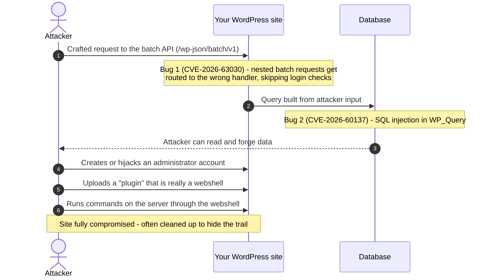

What attackers have been seen doing afterwards:

| Seen in the wild | What it looks like on your site |
|---|---|
| Uploading a webshell as a plugin | A plugin folder like `wp2shell_6a5566a6`, or plugins called **CMSmap**, **WP Static Cache Helper**, or starting with `gg-` |
| Writing a webshell straight to disk | A small PHP file in `wp-content/cache/` or `uploads/` |
| A REST-API backdoor | A plugin that registers `/wp-json/morning/v1/…` and runs any command sent to it |
| Creating admin accounts | Administrators you don't recognise, created after July 17, 2026 |
| Harvesting users and passwords | Requests for `users?context=edit`, attempts to read `wp-config.php` |

## 2. Is my site affected?

Check your version under **Dashboard → Updates** (or the bottom-right of any admin page):

| WordPress version | Risk | Fixed in |
|---|---|---|
| 6.8.0 – 6.8.5 | 🟠 SQL injection only (no full takeover) | **6.8.6** |
| 6.9.0 – 6.9.4 | 🔴 **Full takeover without login** | **6.9.5** |
| 7.0.0 – 7.0.1 | 🔴 **Full takeover without login** | **7.0.2** |
| Older than 6.8, or 6.8.6 / 6.9.5 / 7.0.2 and newer | 🟢 Not affected by wp2shell | — |

> [!IMPORTANT]
> **Updating stops new attacks, but doesn't remove an attacker who already got in.** WordPress forced automatic security updates for this bug, so many sites patched themselves — but if your site was online on an affected version, even briefly after July 17, 2026, scan it.

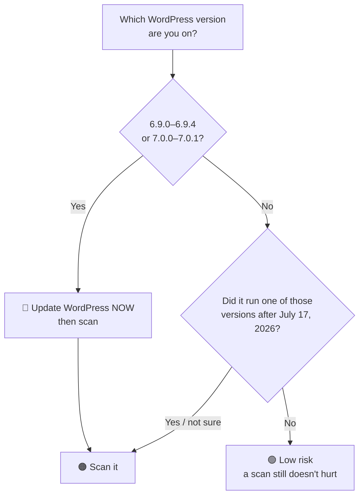

## 3. Install and scan (step by step)

No technical skills needed. It takes about two minutes.

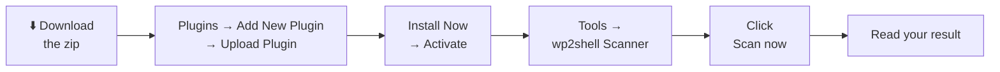

1. **Download** [**wp2shell-scanner.zip**](https://github.com/CptNope/PHP2Shell-WP-scanner/releases/latest/download/wp2shell-scanner.zip). Don't unzip it.
2. Log in to WordPress as an administrator and go to **Plugins → Add New Plugin**.
3. Click **Upload Plugin** (top of the page), then **Choose File**, pick the zip, and click **Install Now**.
4. When it says *"Plugin installed successfully"*, click **Activate Plugin**.
5. Go to **Tools → wp2shell Scanner** (or click **Scan** under the plugin on the Plugins screen).
6. Click **Scan now**. A progress bar shows how it's going. Most sites finish in under a minute; very large ones take a few minutes. You can leave the page open and do something else.
7. Read your result — see [Understanding your results](#4-understanding-your-results).

That's it. From then on it **scans automatically once a week** and **emails you** only if something serious and new turns up.

> [!TIP]
> **Multisite?** Go to **Network Admin → Plugins**, upload, and choose **Network Activate**. The scanner lives under **Network Admin → Settings → wp2shell Scanner** and covers the whole network.

> [!WARNING]
> Use the download link above — **not** GitHub's green **Code → Download ZIP** button. That one is the raw source code; it still works, but the release zip is smaller and cleaner.

**No "Upload Plugin" button?** Some hosts and plans don't allow plugin uploads (for example WordPress.com's lower plans, or sites with `DISALLOW_FILE_MODS` set). Ask your host to install it, or to run the scan for you with [WP-CLI](#12-wp-cli-reference).

## 4. Understanding your results

Every scan ends with one of five results:

| Result | What it means | What to do |
|---|---|---|
| 🟢 **No signs of wp2shell** | No known indicators found. | Nothing. Keep WordPress updated. |
| 🟡 **Needs review** | A few things worth a glance, none alarming on its own — e.g. a must-use plugin you may not recognise. | Look through the list. **Ignore** anything you know is yours. |
| 🟠 **Vulnerable — update WordPress** | No evidence of an attack, **but** your WordPress version can be attacked this way. | Click **Go to WordPress updates**, update, then scan again. |
| 🔴 **Suspicious** | Something needs a closer look today — e.g. a new administrator you may not know, or PHP code where it shouldn't be. | Check each **High** finding. Follow the advice next to it. |
| 🚨 **Compromised** | Strong evidence of an attack — e.g. a known webshell. | Follow [If your site is compromised](#8-if-your-site-is-compromised). |

How the result is decided:

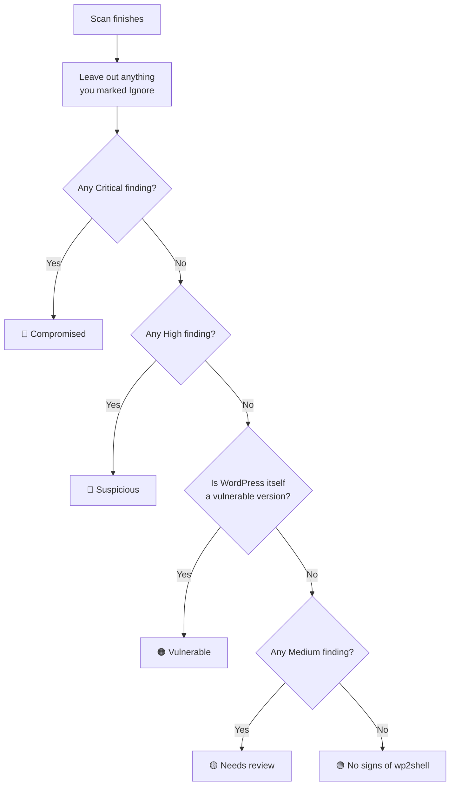

Each finding has a **severity**:

| Severity | Meaning | Examples |
|---|---|---|
| **Critical** | Almost certainly malicious. | A known webshell file; a `wp2shell_…` plugin; successful exploit requests in your log |
| **High** | Very likely bad — check today. | PHP in `uploads/`; an unknown admin; a modified WordPress core file |
| **Medium** | Possibly bad, often innocent. | A must-use plugin changed recently; a folder of PHP with no plugin header |
| **Low** | Usually normal, listed so you can confirm. | Plugins or themes updated since July 17; the admin created when the site was set up |
| **Info** | Just information. | "WordPress 7.0.3 is not affected"; "couldn't reach wordpress.org" |

Each finding also says **what to do** and, where it applies, **where** (a file path, or a link to the user account).

## 5. What it checks

| # | Area | What it looks for | Severity |
|---|---|---|---|
| 1 | **WordPress version** | Versions in the affected ranges ([table above](#2-is-my-site-affected)) | Critical / High → *Vulnerable* |
| 2 | **Plugins** | `wp2shell_<hex>` plugins from the public exploit | Critical |
| | | Fake **CMSmap** plugin (a 150 KB webshell) | Critical |
| | | Fake **WP Static Cache Helper** / "WordPress Performance Team" author | Critical |
| | | Plugins starting `gg-` (REST-API webshell naming) | High |
| | | Folders of PHP in `/plugins` with no plugin header (hidden from the Plugins screen) | Medium |
| | | Single-file plugins sitting loose in `/plugins` | Low |
| | | Plugins installed or updated since July 17, 2026 (one combined line) | Low |
| 3 | **Must-use plugins** | Added/changed since July 17 — these run on every page and are invisible on the Plugins screen. Known host files (Kinsta, WP Engine, GoDaddy, SiteGround…) are only *Low*. | Medium / Low |
| 4 | **Users** | Administrators (and multisite super admins) created since July 17. The account created when the site was set up is recognised and only *Low*. | High |
| | | Application passwords added to admins since July 17 (API access that skips the login screen) | Medium |
| 5 | **REST API** | Routes registered under the `morning/v1` namespace used by a known backdoor | Critical |
| 6 | **Files in `wp-content`** | PHP files in `uploads/`, `cache/`, `upgrade/` (placeholder "Silence is golden" files and cache-plugin files are skipped) | High |
| | | `.htaccess` in those folders that switches PHP on | High |
| | | Hidden PHP files (names starting with a dot) | Medium |
| | | The exploit's leftovers: `wp2shell_*.zip`, `temp-write-test-*`, `wp2shell_<hex>` staging folders | Critical / High |
| | | Theme PHP changed since July 17 (one line per theme) | Low |
| 7 | **Webshell code** | `eval($_POST[…] ?? 'http_response_code(404);')` — the one-liner seen with wp2shell | Critical |
| | | Running code or shell commands straight from a request (`eval`, `assert`, `system`, `passthru`… with request input) | Critical |
| | | REST endpoints anyone can call that run shell commands | Critical |
| | | Packed payloads: `eval(gzuncompress(base64_decode(…)))`, large base64 blobs, split `${'_P'.'OST'}` names, `create_function` with request input | High |
| | | Including a file named by the request; writing request data to disk | High |
| | | Request input + decoder + `eval` in one small file (some legit plugins do this) | Medium |
| 8 | **Known bad files** | SHA-1 hashes of webshells published by researchers | Critical |
| 9 | **This plugin's own folder** | Any PHP file the plugin doesn't ship — attackers like hiding inside security tools | High |
| 10 | **WordPress core** | Core files that differ from the official wordpress.org checksums | High |
| | | Unknown PHP files inside `wp-admin/` or `wp-includes/` | High |
| | | Unknown PHP files in the site root (known extras like `wordfence-waf.php` are allowed) | Medium |
| 11 | **Access log** *(optional)* | Successful (200/207) requests to the batch API — strong sign the exploit worked | Critical |
| | | Exploit-tool user agents (`wp2shell`, `rezwp2shell`, `cve-2026-63030`) | High |
| | | Requests from published attacker IP addresses | High |
| | | Plugin uploads and admin user-enumeration requests | Medium |

**Built not to cry wolf.** Every release is tested against WordPress core and some of the most-installed plugins (WooCommerce, Yoast SEO, Elementor, Jetpack, Contact Form 7, WP Super Cache — over 16,000 PHP files) and must produce **zero** High or Critical matches.

## 6. Settings, automatic scans and email alerts

All settings are on the scanner page (**Tools → wp2shell Scanner**, right-hand box):

| Setting | Default | What it does |
|---|---|---|
| **Automatic scans** | Weekly | Off, Daily or Weekly. The first run happens within an hour of activating. |
| **Email me when an automatic scan finds something new** | On | Emails only when a scheduled scan finds a **new** High/Critical problem, or the site becomes vulnerable. You won't get the same alert twice. |
| **Alert email address** | Site admin email | Where alerts go. |
| **Verify core files against wordpress.org** | On | Downloads the official checksums for your version (cached for a day). Turn off only if your server can't reach wordpress.org. |
| **Web server access log** | *(empty)* | Optional. Full path to your access log so scans can spot exploit traffic. See [Finding your access log](#14-finding-your-access-log). |

You'll also see results:
- in a **red notice** across the admin area when the result is *Compromised*, *Suspicious* or *Vulnerable* (dismissible; it comes back only if a later scan is still bad),
- under **Tools → Site Health** as a "wp2shell scan" check.

How a scheduled scan runs on a host with short time limits:

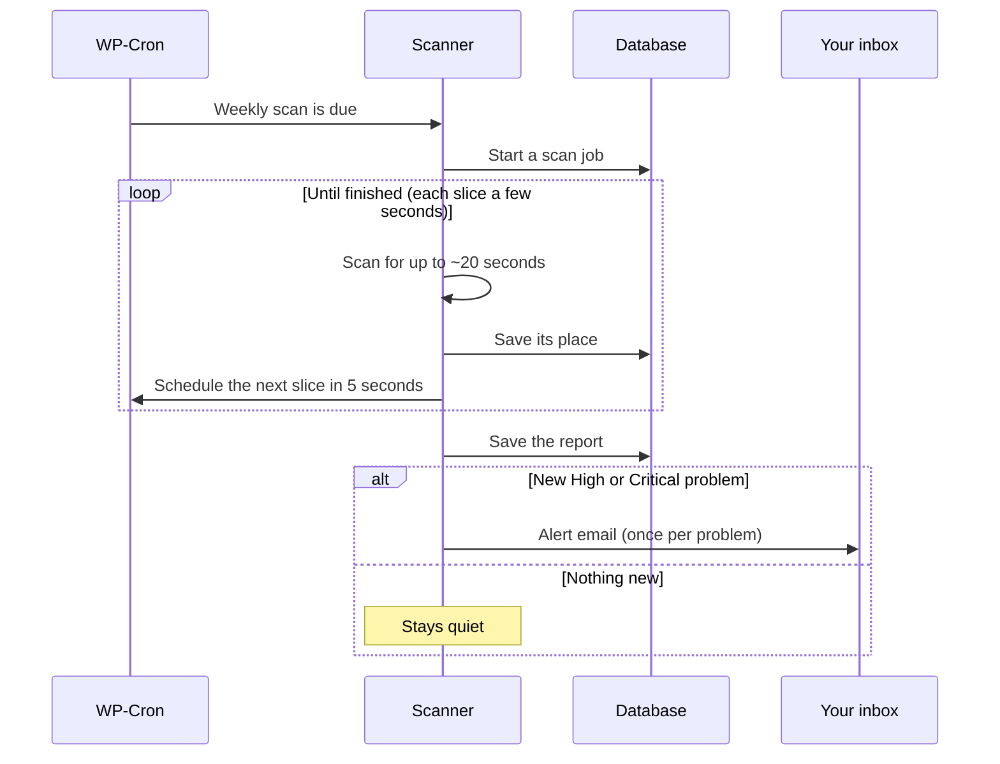

> [!NOTE]
> WordPress's built-in scheduler only runs when someone visits the site. On a very quiet site a scheduled scan may take a while to finish — it always picks up where it left off. If your host runs a real server cron (`DISABLE_WP_CRON`), scans run in bigger slices and finish faster.

## 7. Ignoring things that are yours

If a finding is something you know about — your own admin account, your host's must-use plugin, a plugin you edited — click **Ignore** next to it.

- Ignored findings no longer count toward the result and never trigger an email.
- They're kept in an **"ignored findings"** list at the bottom, where **Restore** brings them back.
- A finding stays ignored even if a date or a count in its text changes later (e.g. your host updates their must-use plugin again).
- From WP-CLI: `wp wp2shell ignore <id>` and `wp wp2shell ignore <id> --undo`.

> [!CAUTION]
> Only ignore things you're sure about. If you're unsure, ask your developer or host — or [open an issue](https://github.com/CptNope/PHP2Shell-WP-scanner/issues) and describe what was flagged (don't post passwords or full file contents).

## 8. If your site is compromised

Don't panic, and don't start deleting things yet. Work through these steps in order:

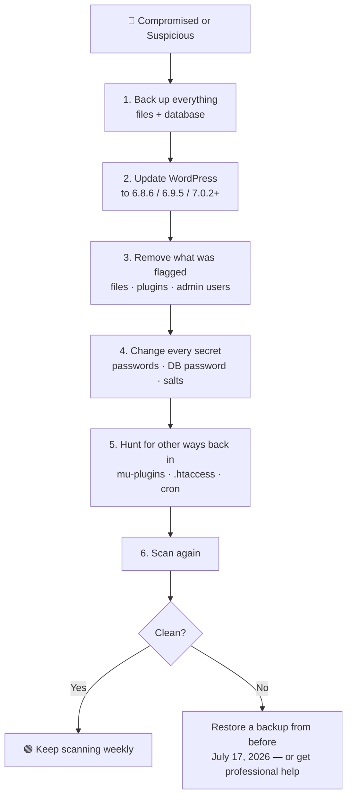

| Step | How |
|---|---|
| **1. Back up** | Use your host's backup tool or a backup plugin to take a full copy of files **and** database. This is your evidence and your undo button. |
| **2. Update WordPress** | **Dashboard → Updates → Update to version …**. Update all plugins and themes while you're there. |
| **3. Remove what was flagged** | Delete flagged plugins on the **Plugins** screen. Delete flagged files with your host's file manager or SFTP. Delete unknown admins under **Users** (assign their content to yourself). For modified core files, use **Dashboard → Updates → Re-install version …**. |
| **4. Change every secret** | Reset the password of **every** administrator. Revoke application passwords you don't recognise (**Users → Profile**). Change the database password in your hosting panel and in `wp-config.php`. Replace the security keys ("salts") in `wp-config.php` with fresh ones from the [WordPress salt generator](https://api.wordpress.org/secret-key/1.1/salt/) — this logs everyone out. |
| **5. Look for other ways back in** | Check `wp-content/mu-plugins/`, every `.htaccess` file, scheduled tasks (a plugin such as WP Crontrol lists them), your hosting panel's cron jobs, and FTP/SFTP accounts. |
| **6. Scan again** | Click **Scan again**. Repeat until the result is clean. |

> [!TIP]
> Not comfortable doing this yourself? Your host's support team or a WordPress security service can clean the site for you — many do it for a fixed fee. Show them the **Download report (JSON)** file; it lists everything that was found.

## 9. Updating the plugin

The plugin **updates itself** from this GitHub repository, through the normal WordPress update screen — exactly like plugins from wordpress.org.

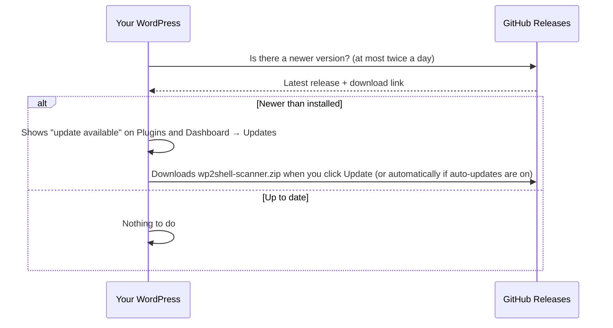

- Click **Update now** when WordPress offers it — or click **Enable auto-updates** on the Plugins screen and forget about it.
- Updates are only downloaded from this repository's official releases.
- Manual update: download the latest zip and upload it again under **Plugins → Add New Plugin → Upload Plugin**; WordPress offers to **Replace current with uploaded**.

## 10. Troubleshooting

| Problem | Likely cause | Fix |
|---|---|---|
| No **Upload Plugin** button | Host or plan blocks uploads, or `DISALLOW_FILE_MODS` is set | Ask your host to install it, or use WP-CLI |
| "The uploaded file exceeds the upload_max_filesize" | Very low upload limit | The zip is under 100 KB; ask your host to raise the limit, or upload via SFTP to `wp-content/plugins/` |
| Progress bar stops with "The scan stopped: HTTP 500/503/504" | Host killed the request (very strict limits) or a temporary hiccup | It retries automatically three times. Click **Scan again** — it continues where it stopped. |
| Progress bar sits still for a while | Another tab, or a scheduled scan, is working on the same scan | Normal — they take turns. It moves on within seconds. |
| "Your session expired" | You were logged out | Reload the page and log in again |
| "Couldn't download core checksums" | Server can't reach wordpress.org | Harmless; other checks still ran. Your host can run `wp core verify-checksums`. |
| "Access log not readable" | Wrong path, or PHP isn't allowed to read it (`open_basedir`, permissions) | See [Finding your access log](#14-finding-your-access-log), or leave the setting empty |
| Lots of **Low** findings about plugin/theme updates | You (or auto-updates) updated things after July 17 | Expected. Glance at the names; **Ignore** them. |
| An admin you know is flagged | It was created after July 17, 2026 | If it's yours, click **Ignore** |
| Weekly scans don't seem to run | Quiet site, or WP-Cron disabled with no server cron | Visit the site occasionally, or ask your host to set up a real cron for `wp-cron.php` |
| No alert emails arrive | Your site can't send email | Install an SMTP plugin; check the **Alert email address** |
| "The … stopped early: …" info finding | One check hit an unexpected error; the rest of the scan still ran | Please [open an issue](https://github.com/CptNope/PHP2Shell-WP-scanner/issues) with that message |
| The admin notice keeps coming back | A later scan still has the same problem | Fix it, or **Ignore** it if it's yours |

## 11. FAQ

<details><summary><b>Will it change, quarantine or delete anything?</b></summary>

No. It only reads. You decide what to remove — that way it can never break your site by mistake.
</details>

<details><summary><b>Will it slow my site down?</b></summary>

No. It does nothing for visitors. Scans run only when you click **Scan** or on the weekly schedule, in short slices.
</details>

<details><summary><b>It says "Vulnerable". Was I hacked?</b></summary>

Not necessarily. "Vulnerable" means no evidence of an attack was found, but your WordPress version can be attacked this way. Update WordPress right away, then scan again.
</details>

<details><summary><b>It says "No signs". Am I definitely safe?</b></summary>

It means none of the known traces were found. Attackers can rename and rewrite things, so no scanner can promise 100%. If your site ran an affected version while online, consider also reviewing your admin users and recent changes yourself.
</details>

<details><summary><b>Does it work with Wordfence / Sucuri / Solid Security / my host's scanner?</b></summary>

Yes. It's narrowly focused on wp2shell and doesn't conflict with general security plugins. It complements them rather than replacing them.
</details>

<details><summary><b>Does it send my data anywhere?</b></summary>

No. See [Privacy and stored data](#17-privacy-and-stored-data).
</details>

<details><summary><b>Can I remove it once I'm sure my site is clean?</b></summary>

Yes. Deactivate and delete it on the Plugins screen; it removes everything it stored. Keeping it means you get weekly checks and alerts, which is useful because new indicators are added in updates.
</details>

<details><summary><b>Is it on wordpress.org?</b></summary>

Not yet — it's distributed here on GitHub and updates itself from here.
</details>

---

## 12. WP-CLI reference

For people with command-line access. Everything the dashboard does is available here too.

| Command | What it does |
|---|---|
| `wp wp2shell scan` | Run a full scan now and print the findings |
| `wp wp2shell status` | Show the last result without scanning again |
| `wp wp2shell ignore <id>…` | Mark finding(s) as ignored (`--undo` to restore) |

**`wp wp2shell scan` options**

| Option | Default | Meaning |
|---|---|---|
| `--log=<path>` | The path saved in settings | Access log to check (`.gz` works) |
| `--skip-core` | off | Don't verify core files against wordpress.org |
| `--min=<severity>` | `low` | Hide findings below `info`, `low`, `medium`, `high` or `critical` |
| `--format=<format>` | `table` | `table`, `json`, `csv`, `yaml` or `summary` (one line) |
| `--include-ignored` | off | Also list findings marked as ignored |

**Exit codes** — handy for scripts and monitoring:

| Code | Result |
|---|---|
| `0` | No signs of wp2shell, or Needs review |
| `1` | Vulnerable, or Suspicious |
| `2` | Compromised |

**Examples**

```bash
wp wp2shell scan                                        # human-readable table
wp wp2shell scan --min=high                             # only what needs action
wp wp2shell scan --log=/var/log/nginx/access.log        # include exploit traffic
wp wp2shell scan --format=json > wp2shell-report.json   # full report
wp wp2shell scan --format=summary                       # COMPROMISED  https://example.com  wp 7.0.1  critical:2 high:1 medium:0
wp wp2shell scan --format=json | jq -r '.findings[] | select(.severity=="critical") | .message'
wp wp2shell status --format=table
wp wp2shell ignore 3f9a1c2b7d10
```

**Install with WP-CLI**

```bash
wp plugin install https://github.com/CptNope/PHP2Shell-WP-scanner/releases/latest/download/wp2shell-scanner.zip --activate
# Multisite: add --network
```

## 13. Scanning many sites

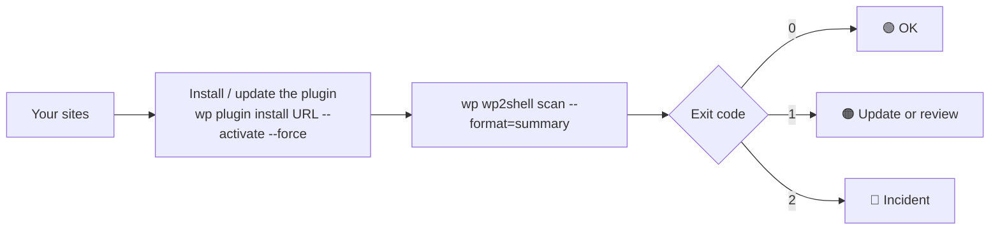

**With WP-CLI aliases** (`@all` defined in `wp-cli.yml`):

```bash
URL=https://github.com/CptNope/PHP2Shell-WP-scanner/releases/latest/download/wp2shell-scanner.zip
wp @all plugin install "$URL" --activate --force
wp @all wp2shell scan --format=summary
```

**Every WordPress on one server**, with a summary of the bad ones:

```bash
#!/usr/bin/env bash
URL=https://github.com/CptNope/PHP2Shell-WP-scanner/releases/latest/download/wp2shell-scanner.zip
for wp in $(find /var/www /home -maxdepth 4 -name wp-config.php -printf '%h\n' 2>/dev/null); do
  wp --path="$wp" plugin install "$URL" --activate --force --quiet 2>/dev/null
  wp --path="$wp" wp2shell scan --format=summary 2>/dev/null
  case $? in 2) echo "!!! COMPROMISED: $wp";; 1) echo "!   check: $wp";; esac
done
```

> Run as the user that owns each site (e.g. `sudo -u www-data …`), not as root, so file ownership doesn't change. Add `--allow-root` only if you must.

**Collect JSON reports centrally**

```bash
for wp in /var/www/*/; do
  wp --path="$wp" wp2shell scan --format=json > "reports/$(basename "$wp").json"
done
jq -r '[.site, .verdict] | @tsv' reports/*.json | sort -k2
```

## 14. Finding your access log

The access log lets the scanner see attack *traffic*, not just leftovers. It's optional. PHP must be able to read the file — on shared hosting it often can't, and that's fine.

| Setup | Typical location |
|---|---|
| Apache on Debian / Ubuntu | `/var/log/apache2/access.log` (or `other_vhosts_access.log`) |
| Apache on RHEL / CentOS / Alma / Rocky | `/var/log/httpd/access_log` |
| Nginx | `/var/log/nginx/access.log` (or a per-site file set in the server block) |
| LiteSpeed / OpenLiteSpeed | `/usr/local/lsws/logs/access.log` |
| cPanel | `~/access-logs/<your-domain>` · server-wide `/usr/local/apache/domlogs/<your-domain>` |
| Plesk | `/var/www/vhosts/<your-domain>/logs/access_log` |
| Managed WordPress hosts | Usually not readable by PHP — use the host's log viewer, or ask support |

Rotated logs (`access.log.1`, `access.log.2.gz`) hold older activity — point a one-off CLI scan at them: `wp wp2shell scan --log=/var/log/nginx/access.log.2.gz`.

## 15. Hosting compatibility

| Environment | Works? | Notes |
|---|---|---|
| Shared hosting with 30-second PHP limits | ✅ | Scans run in slices of a few seconds with automatic resume |
| Managed WordPress (WP Engine, Kinsta, SiteGround, GoDaddy, …) | ✅ | Hosts' own must-use plugins are recognised as low-risk |
| `DISABLE_WP_CRON` with a real server cron | ✅ | Scheduled scans run in bigger slices |
| Quiet sites (WP-Cron rarely triggered) | ✅ | Scheduled scans resume across visits; nothing is lost |
| Persistent object cache (Redis, Memcached) | ✅ | Job state is read fresh each slice |
| Multisite | ✅ | Network-wide, one report; covers admins on every site |
| Server blocks outbound requests | ✅ | Core-checksum check is skipped with a note; updates can't be fetched |
| `open_basedir` restrictions | ✅ | Unreadable paths are counted and skipped |
| Symlinked plugin folders | ✅ | Followed once each; loops are detected |
| Huge folders (100,000+ files) | ✅ | Read one entry at a time, never loaded whole |
| Windows / IIS | ⚠️ | Should work (paths are normalised) but isn't tested in CI |
| PHP 7.4 → 8.4 · WordPress 6.0 → 7.x | ✅ | Tested in CI on every change |
| SQLite (WordPress Playground, etc.) | ✅ | Used in local testing |

## 16. How it works inside

**The files**

| File | Job |
|---|---|
| `wp2shell-scanner.php` | Plugin header, constants, loads everything, activation/deactivation |
| `includes/signatures.php` | **All indicators** — versions, hashes, IPs, user agents, code patterns. Easy to review and extend. |
| `includes/class-scanner.php` | The scan engine: resumable job, locking, every check |
| `includes/class-admin.php` | The admin page, AJAX scanning, ignore list, admin notice |
| `includes/class-cron.php` | Scheduled scans and email alerts |
| `includes/class-settings.php` | Settings storage |
| `includes/class-site-health.php` | Tools → Site Health test |
| `includes/class-updater.php` | Updates from GitHub releases |
| `includes/class-cli.php` | WP-CLI commands |
| `assets/admin.js`, `assets/admin.css` | Progress bar, ignore buttons (no jQuery, no external files) |
| `uninstall.php` | Removes everything on delete |

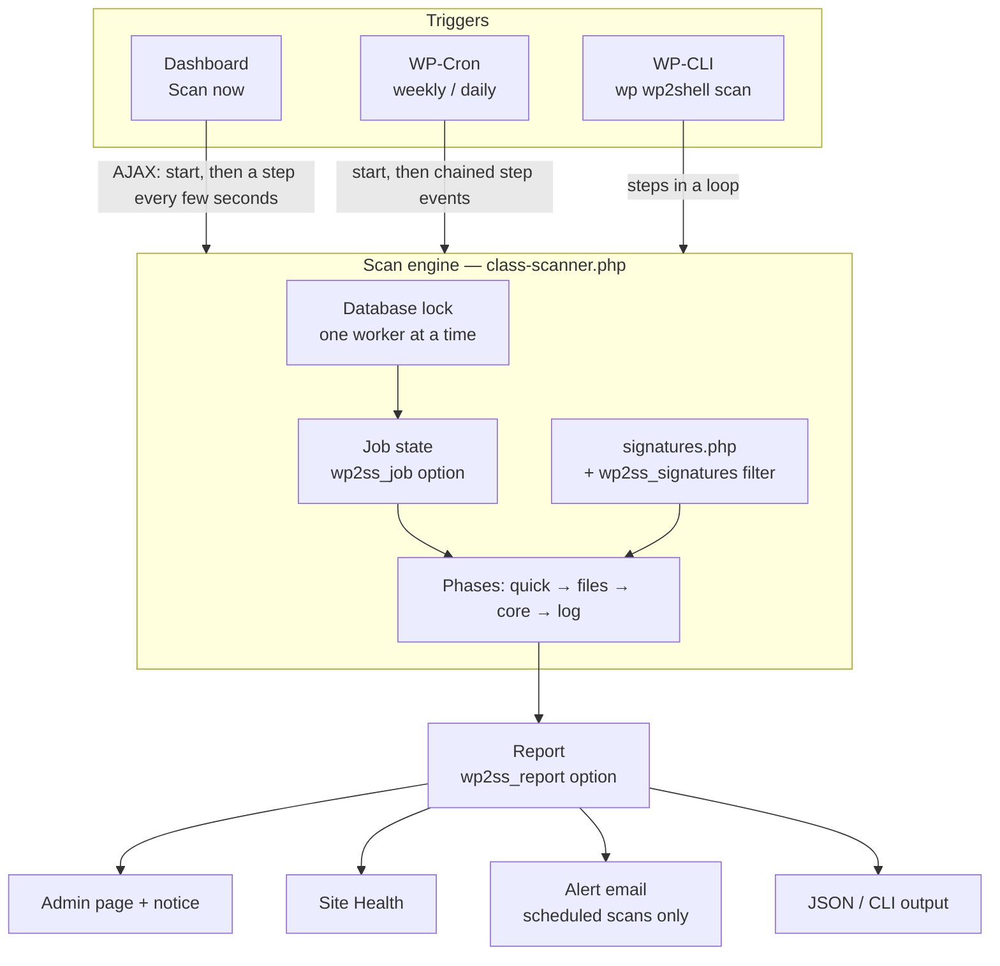

**A scan is a resumable job.** Instead of one long request (which cheap hosts kill after 30 seconds), the scanner does a few seconds of work, saves exactly where it is — down to the position inside a folder — and continues on the next request.

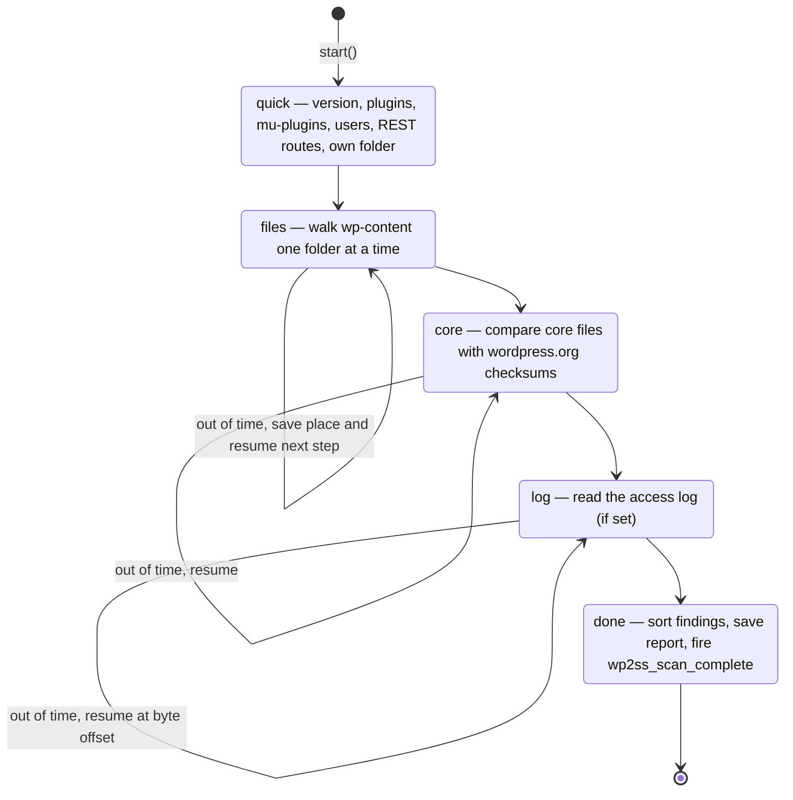

**One worker at a time.** Each slice takes a short database lock. If two browser tabs — or a tab and a scheduled scan — try to work at once, the second simply waits its turn (the progress bar keeps polling). A lock left behind by a request that crashed expires after 5 minutes.

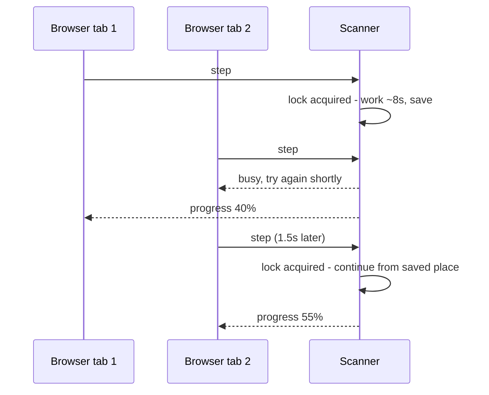

**Robustness built in**

| Situation | What the scanner does |
|---|---|
| A check throws an unexpected error | Reports it as an *Info* finding and carries on with the rest |
| A file can't be read | Counts it as unreadable and moves on |
| A PHP file over 5 MB | Hashes it, and checks the first and last 1 MB (where injected code sits) |
| A folder with hundreds of thousands of files | Reads it entry by entry and can stop mid-folder |
| Symlinked folders | Follows each target once (max 200); skips loops |
| The scan pauses for hours (quiet site) | Resumes; only a job with no progress for 24 hours is abandoned |
| Plugin updated in the middle of a scan | Old-format job is discarded and a fresh one starts |
| A badly infected site | Stores at most 1,000 findings and says how many more there were |

## 17. Privacy and stored data

**Nothing about your site is sent anywhere.** The only outside requests are:

| Request | When | Why |
|---|---|---|
| `api.wordpress.org` — core checksums | During a scan, at most once a day (cached) | To check core files are untouched. Turn off in settings. |
| `api.github.com` — latest release | At most twice a day | To offer plugin updates. Disable with `WP2SS_DISABLE_UPDATER`. |
| `github.com` — release zip | Only when you install an update | The update itself |

**What it stores** (all removed when you delete the plugin):

| Name | Where | Contents |
|---|---|---|
| `wp2ss_settings` | Options | Your settings |
| `wp2ss_report` | Options | The latest report |
| `wp2ss_job` | Options | A scan in progress (deleted when it finishes) |
| `wp2ss_ignored` | Options | IDs of findings you ignored |
| `wp2ss_lock` | Options (main site) | Short-lived lock while a slice runs |
| `wp2ss_release`, `wp2ss_core_*` | Transients | Cached update info and core checksums |
| `wp2ss_dismissed` | User meta | Which report's notice you dismissed |
| `wp2ss_scheduled_scan`, `wp2ss_scan_step` | WP-Cron | Scheduled scan events |

On multisite these live in network-wide (site) options.

## 18. Hooks, filters and constants

| Name | Type | Use |
|---|---|---|
| `wp2ss_signatures` | Filter | Add or change indicators (code patterns, hashes, IPs, user agents…). Receives the array from `includes/signatures.php`. |
| `wp2ss_step_budget` | Filter | Seconds of work per slice (float). Lower it on very strict hosts. |
| `wp2ss_scan_complete` | Action | Fires with `( $report, $previous_report )` when a scan finishes — send it to Slack, a SIEM, your monitoring… |
| `WP2SS_DISABLE_UPDATER` | Constant | `define( 'WP2SS_DISABLE_UPDATER', true );` in `wp-config.php` to stop update checks to GitHub |

**Add your own code signature**

```php
add_filter( 'wp2ss_signatures', function ( $sig ) {
    // [ severity, regex, description ]
    $sig['code'][] = array( 'high', '/my_known_bad_function\s*\(/i', 'Our internal backdoor marker' );
    $sig['sha1']['0123456789abcdef0123456789abcdef01234567'] = 'Sample from our incident';
    return $sig;
} );
```

**Post every result to Slack**

```php
add_action( 'wp2ss_scan_complete', function ( $report ) {
    wp_remote_post( 'https://hooks.slack.com/services/XXX', array(
        'body' => wp_json_encode( array( 'text' => $report['site'] . ': ' . $report['verdict'] ) ),
        'headers' => array( 'Content-Type' => 'application/json' ),
    ) );
} );
```

## 19. Report format (JSON)

What **Download report (JSON)** and `wp wp2shell scan --format=json` produce:

| Field | Type | Meaning |
|---|---|---|
| `id` | string | Unique ID of this scan |
| `site` | string | Site URL |
| `wp` | string | WordPress version |
| `plugin` | string | Scanner version |
| `source` | string | `manual`, `cron` or `cli` |
| `scanned` | string | Finish time, ISO 8601 UTC |
| `duration` | int | Seconds from start to finish |
| `verdict` | string | `CLEAN`, `REVIEW`, `VULNERABLE`, `SUSPICIOUS`, `COMPROMISED` |
| `stats` | object | `files`, `php_files`, `dirs`, `unreadable`, `links`, `large`, `errors` |
| `findings[]` | array | See below |
| `ignored` | array | IDs you ignored (dashboard download only) |

| `findings[]` field | Meaning |
|---|---|
| `id` | Stable 12-character ID (use with `wp wp2shell ignore`) |
| `severity` | `critical`, `high`, `medium`, `low`, `info` |
| `type` | `version`, `plugin`, `mu-plugin`, `user`, `rest`, `file`, `code`, `hash`, `core`, `log`, `scan` |
| `message` | What was found |
| `advice` | What to do about it |
| `location` | File path, `user:<ID>`, `rest:<namespace>`, or empty |

## 20. Development, tests and releases

```bash
# Integration tests — they plant FAKE malware files, so only use a throwaway site
tests/integration.sh /path/to/throwaway/wordpress

# False-positive check — signatures vs. legitimate code
php tests/false-positives.php /path/to/wordpress /path/to/some/plugins

# Mermaid diagrams in this README
npm i mermaid@11 jsdom && node tests/check-mermaid.mjs README.md
```

**What CI checks on every push**

| Job | What |
|---|---|
| PHP syntax | Every file on PHP 7.4, 8.0, 8.1, 8.2, 8.3, 8.4 |
| Integration | Real WordPress + MySQL: latest WP on PHP 7.4 and 8.4, and the vulnerable 7.0.1 and 6.9.4. ~50 checks: detection, false-positive bait, evasion (padded files, symlinks, hiding in the scanner's own folder), resumable slices, locking, crash isolation, ignore list, exit codes. Fails on any PHP notice from the plugin. |
| False positives | Signatures vs. WordPress core, WooCommerce, Yoast SEO, Elementor, Jetpack, Contact Form 7, WP Super Cache — zero High/Critical allowed |
| Docs | Every Mermaid diagram in this README must parse |

**How a release happens**

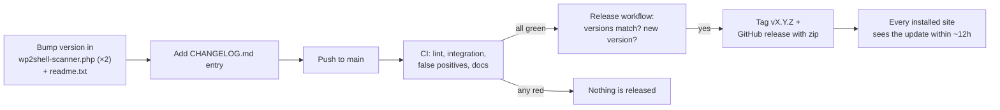

Pushing a `vX.Y.Z` tag yourself also triggers a release. Detection rules live in [`includes/signatures.php`](includes/signatures.php) — **new indicators are very welcome**: open an issue or pull request with a link to the source.

## 21. Limits

- Detection is based on public exploit tools, published samples and research. Attackers can rename files and rewrite code, so "no signs" means **no known indicators**, not a guarantee.
- It looks for wp2shell specifically. It isn't a general antivirus — keep using your usual security plugin or host scanner.
- It reads files and the database; it doesn't inspect your server outside WordPress (system cron, other sites, SSH keys).
- Findings text is in English; the interface is translation-ready (`languages/wp2shell-scanner.pot`).

## 22. Security

Found a security problem **in this plugin**? Please report it privately via **Security → Report a vulnerability** on this repository — see [SECURITY.md](SECURITY.md). New wp2shell indicators aren't secret; share them as a normal issue or pull request.

## 23. Sources

- [Wiz Research — Exploitation in the Wild of wp2shell](https://www.wiz.io/blog/wp2shell-cve-2026-63030-cve-2026-60137)
- [Elastic Security Labs — wp2shell detection end to end](https://www.elastic.co/security-labs/blog/wp2shell-wordpress-rce-detection-elastic-defend)
- [MalwareBazaar — wp-static-cache webshell sample](https://bazaar.abuse.ch/sample/4b7ff0262fe7d98cfd1c3ec38cb17d1aa7b66524be8fa2de0ce7a30a3d81fa38/)
- [Malwarebytes — What happens if you visit a site hacked through wp2shell](https://www.malwarebytes.com/blog/bugs/2026/07/what-happens-if-you-visit-a-wordpress-site-hacked-through-wp2shell)

## 24. License

MIT — see [LICENSE](LICENSE). Changes are listed in [CHANGELOG.md](CHANGELOG.md).
