<div align="center">

# 🛡️ PHP2Shell & wp2shell Scanner

**Find out in two minutes whether your WordPress site is exposed to — or has already been broken into through — the October 2026 PHP2Shell attack on PHP, and the July 2026 wp2shell attack on WordPress.**

[](https://github.com/CptNope/PHP2Shell-WP-scanner/actions/workflows/ci.yml)
[](https://github.com/CptNope/PHP2Shell-WP-scanner/releases/latest)
[](https://github.com/CptNope/PHP2Shell-WP-scanner/releases)


[](LICENSE)

### [⬇️ Download wp2shell-scanner.zip](https://github.com/CptNope/PHP2Shell-WP-scanner/releases/latest/download/wp2shell-scanner.zip)

**Current version: 1.3.2** (October 22, 2026) · [What's new](#whats-new) · [Full changelog](CHANGELOG.md)

Free · scans only read · optional one-click fixes you can undo · self-hosted fleet dashboard · no account · nothing sent to us


</div>

> [!IMPORTANT]
> **PHP2Shell is a bug in PHP itself, not in WordPress.** Updating WordPress or your plugins does **not** fix it — the PHP on your server has to be updated, which on most hosting plans means **your host**. This plugin tells you whether you're affected and gives you a ready-made message to send them.

---

## What's new

| Version | Highlights |
|---|---|
| **1.3.2** | Recognises the **Installatron Worker** (`it-api.php`, used by IONOS and other hosts for one-click installs) by its signature check, and hidden **data files** that can only answer "404 Not Found" (a plugin's stored key or settings) — no more false "backdoor" alarms for either |
| **1.3.1** | No false alarms for WordPress's own leftover `temp-write-test-…` files (dated from their names) or for WordPress 7.0 files left behind after updating (checked against official fingerprints) |
| **1.3.0** | Security fixes from an independent review (per-site fleet identities, safer quarantine), **fleet alerts** by email/Slack/Discord, **Scan again** for member sites, new PHP2Shell intel, screenshots and demo |
| **1.2.0** | **One-click fixes** with undo, the **fleet dashboard**, redesigned scanner page |

Update from **Dashboard → Updates** (the scanner updates itself from GitHub), or upload the new zip over the old one: **Plugins → Add New Plugin → Upload Plugin → Replace current with uploaded**.

## Contents

**For site owners**
1. [What are PHP2Shell and wp2shell?](#1-what-are-php2shell-and-wp2shell)
2. [Is my site affected?](#2-is-my-site-affected)
3. [Install and scan (step by step)](#3-install-and-scan-step-by-step)
4. [Understanding your results](#4-understanding-your-results)
5. [Getting your host to update PHP](#5-getting-your-host-to-update-php)
6. [What it checks](#6-what-it-checks)
7. [Settings, automatic scans and email alerts](#7-settings-automatic-scans-and-email-alerts)
8. [Ignoring things that are yours](#8-ignoring-things-that-are-yours)
9. [If your site is compromised](#9-if-your-site-is-compromised)
10. [Updating the plugin](#10-updating-the-plugin)
11. [Troubleshooting](#11-troubleshooting)
12. [FAQ](#12-faq)

**For agencies, hosts and developers**

13. [WP-CLI reference](#13-wp-cli-reference)
14. [Scanning many sites](#14-scanning-many-sites)
15. [Finding your logs](#15-finding-your-logs)
16. [Hosting compatibility](#16-hosting-compatibility)
17. [How it works inside](#17-how-it-works-inside)
18. [Privacy and stored data](#18-privacy-and-stored-data)
19. [Hooks, filters and constants](#19-hooks-filters-and-constants)
20. [Report format (JSON)](#20-report-format-json)
21. [Development, tests and releases](#21-development-tests-and-releases)
22. [Limits](#22-limits) · [Security](#23-security) · [Sources](#24-sources) · [License](#25-license)

---

## 1. What are PHP2Shell and wp2shell?

Two separate, critical attacks hit WordPress sites in 2026. Both let a stranger run their own code on your server **without logging in**, and both end the same way — with a backdoor ("webshell") on your site. This plugin checks for both.

| | 🔴 **PHP2Shell** | 🟠 **wp2shell** |
|---|---|---|
| **What's broken** | **PHP itself** — the language WordPress runs on | WordPress core |
| **CVE numbers** | CVE-2026-109618, CVE-2026-109619 | CVE-2026-63030, CVE-2026-60137 |
| **Made public** | October 21, 2026 | July 17, 2026 |
| **Attacks seen since** | October 17, 2026 — *before* it was announced | Within hours of July 17, 2026 |
| **Severity** | CVSS 9.2 (critical) | Critical |
| **Who is affected** | Practically every PHP website — WordPress, Drupal, Magento, anything — on unpatched PHP | WordPress 6.8 – 7.0.1 |
| **Extra danger** | Can also **leak memory**: passwords, keys and tokens that passed through PHP | Creates admin accounts and uploads plugins |
| **Fixed by** | **Updating PHP** — usually your host's job | **Updating WordPress** — usually automatic |

### How PHP2Shell works

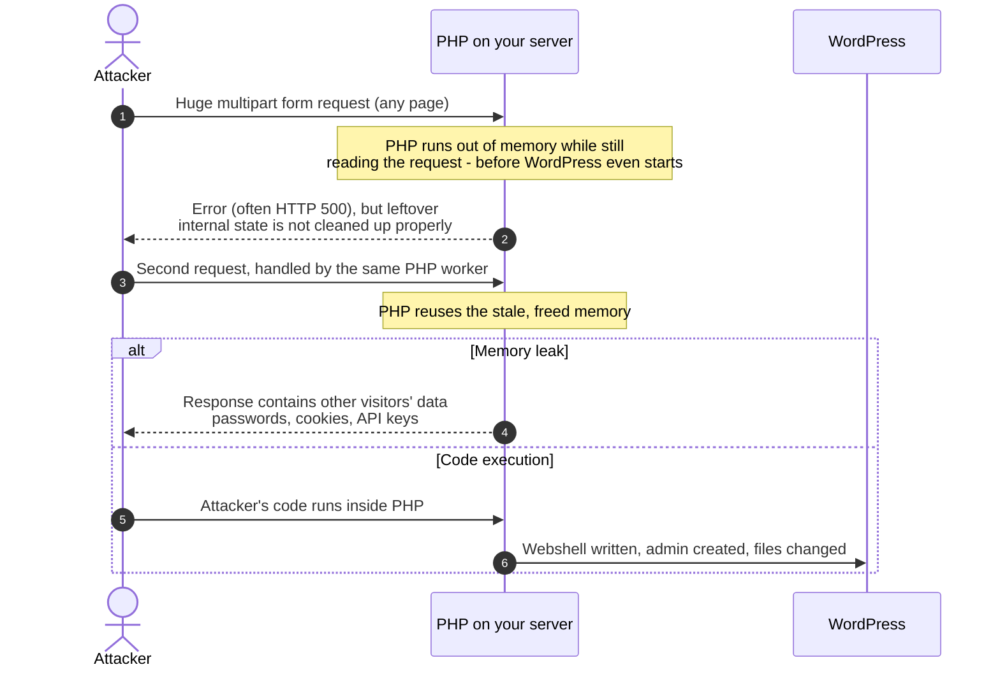

| CVE | What goes wrong inside PHP |
|---|---|
| **CVE-2026-109618** | Memory corruption when PHP runs out of memory part-way through reading a request |
| **CVE-2026-109619** | State left over from one request (including upload-progress tracking) is reused by the next |

Either one can be chained into a memory leak or into running code — so don't read the diagram as "leak = one CVE, code = the other".

Because the bug sits **underneath** WordPress, no WordPress setting, security plugin or maintenance mode can stop it. Only a patched PHP (or temporary php.ini settings your host can apply) does.

### How wp2shell works

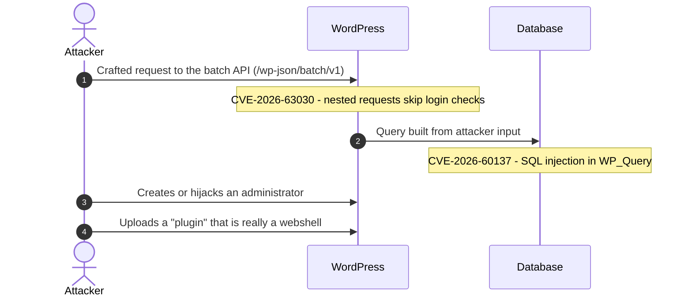

### What attackers leave behind

| Seen after these attacks | What it looks like on your site |
|---|---|
| A webshell disguised as a plugin | A plugin folder like `wp2shell_6a5566a6`, or plugins called **CMSmap**, **WP Static Cache Helper**, or starting with `gg-` |
| A webshell dropped straight onto disk | A small PHP file in `wp-content/cache/`, `uploads/`, `wp-content/` itself or the site root |
| A hidden REST backdoor | A plugin that registers `/wp-json/morning/v1/…` and runs any command sent to it |
| New or promoted admin accounts | Administrators you don't recognise |
| Stolen secrets (PHP2Shell) | Nothing visible — which is why you should change passwords and keys if you were exposed |
| Traces in server logs (PHP2Shell) | "Allowed memory size … exhausted … in Unknown on line 0", PHP worker crashes, bursts of failed POSTs, the public scanner tools (`php2shell-scan`, `php2shell-verify`, `JACKALPOC`) in the access log |
| A second-stage program (PHP2Shell) | A Linux program called `nfs` dropped in `/tmp` |

## 2. Is my site affected?

You need to check **two** things: your **PHP** version (for PHP2Shell) and your **WordPress** version (for wp2shell). The scanner checks both for you, and shows your PHP version on its page. You can also find it under **Tools → Site Health → Info → Server**.

### PHP (PHP2Shell)

| Your PHP version | Status | What to do |
|---|---|---|
| **8.5.12+**, **8.4.27+**, **8.3.36+**, **8.2.35+** | 🟢 Fixed | Nothing for PHP2Shell |
| 8.5.0 – 8.5.11 · 8.4.0 – 8.4.26 · 8.3.0 – 8.3.35 · 8.2.0 – 8.2.34 | 🔴 Vulnerable — unless your host patched it without changing the number (see below) | Ask your host to update or confirm |
| 7.4, 8.0, 8.1 | 🔴 No official fix — the PHP team only published source-code patches | Ask your host whether they applied them; plan a move to 8.2+ |
| 7.3 and older (5.4 – 7.3) | 🚨 **Will never be fixed** | Move to PHP 8.2+ as soon as possible |

> [!NOTE]
> **"My version number looks old, but my host says it's patched."** That can be true. Linux distributions (Ubuntu, Debian, AlmaLinux, Rocky, CloudLinux, Red Hat…) often fix PHP **without changing its version number**. The scanner detects this situation and says *"ask your host to confirm"* instead of *"vulnerable"*. If they confirm, click **Ignore** on that finding.
>
> On **Ubuntu and Debian** the scanner can usually settle this itself: it reads the installed package version (for example `8.3.6-0ubuntu0.24.04.13`) and knows which package builds carry the fix. On other systems it also looks at **when PHP was built** — a PHP compiled after October 21, 2026 is reported as *probably patched*.

| Distribution | PHP | First fixed package |
|---|---|---|
| Ubuntu 26.10 | 8.5 | `8.5.9-0ubuntu2.1` |
| Ubuntu 26.04 LTS | 8.5 | `8.5.4-0ubuntu1.5` |
| Ubuntu 24.04 LTS | 8.3 | `8.3.6-0ubuntu0.24.04.13` |
| Ubuntu 22.04 LTS | 8.1 | `8.1.2-1ubuntu2.28` |
| Ubuntu 20.04 (ESM) | 7.4 | `7.4.3-4ubuntu2.29+esm5` |
| Ubuntu 18.04 (ESM) | 7.2 | `7.2.24-0ubuntu0.18.04.17+esm14` |
| Ubuntu 16.04 (ESM) | 7.0 | `7.0.33-0ubuntu0.16.04.16+esm22` |
| Debian 13 | 8.4 | `8.4.27-1~deb13u1` (DSA-6574-1) |
| Debian 12 | 8.2 | `8.2.35-1~deb12u1` (DLA-4848-1) |
| RHEL 9 (php:8.2 module) | 8.2 | `php-8.2.35-1.module+el9.8.0…` (RHSA-2026:87072) |

Debian and Red Hat moved to the fixed upstream version numbers, so the normal version check covers them. At the time of writing, Alpine, Homebrew, the Docker official `php` image and Remi had **not** shipped fixed builds yet.

### WordPress (wp2shell)

| Your WordPress version | Status | Fixed in |
|---|---|---|
| 6.8 – 6.8.5 | 🟠 SQL injection only | **6.8.6** |
| 6.9 – 6.9.4 | 🔴 Full takeover without login | **6.9.5** |
| 7.0 – 7.0.1 | 🔴 Full takeover without login | **7.0.2** |
| Older than 6.8, or 6.8.6 / 6.9.5 / 7.0.2 and newer | 🟢 Not affected | — |

> [!IMPORTANT]
> **Patching closes the door — it doesn't remove someone already inside.** If your site ran a vulnerable PHP after **October 17, 2026**, or a vulnerable WordPress after **July 17, 2026**, run a scan to look for signs of a break-in.

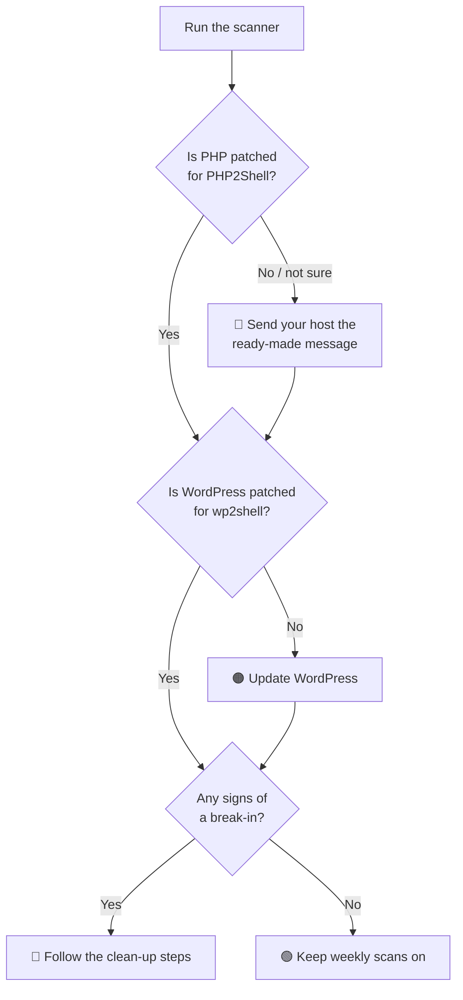

## 3. Install and scan (step by step)

No technical skills needed. It takes about two minutes.

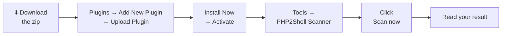

1. **Download** [**wp2shell-scanner.zip**](https://github.com/CptNope/PHP2Shell-WP-scanner/releases/latest/download/wp2shell-scanner.zip). Don't unzip it.
2. Log in to WordPress as an administrator and go to **Plugins → Add New Plugin**.
3. Click **Upload Plugin** (top of the page), then **Choose File**, pick the zip, and click **Install Now**.
4. When it says *"Plugin installed successfully"*, click **Activate Plugin**.
5. Go to **Tools → PHP2Shell Scanner** (or click **Scan** under the plugin on the Plugins screen).
6. Click **Scan now**. A progress bar shows how it's going. Most sites finish in under a minute; very large ones take a few minutes.
7. Read your result — see [Understanding your results](#4-understanding-your-results).

**What the scanner page looks like**

| Part | What it shows |
|---|---|
| **Result at the top** | One plain sentence ("Your site looks clean", "Your host needs to update PHP"…) and three panels: **PHP2Shell**, **wp2shell** and **Signs of a break-in**, each green, amber or red |
| **What to do next** | Your personal to-do list in order — back up, message your host, update WordPress, quarantine flagged files, check admins, change secrets, scan again — only the steps that apply to you |
| **Findings** tab | Everything found, grouped by area, with **Needs action / Everything / Ignored** filters and the fix buttons |
| **Quarantine** tab | What you've quarantined or demoted, with **Restore** and **Delete** |
| **Fleet** tab | The [multi-site dashboard](#the-fleet-dashboard-easiest) |
| **Settings** tab | Schedule, email alerts, log paths |

<p>
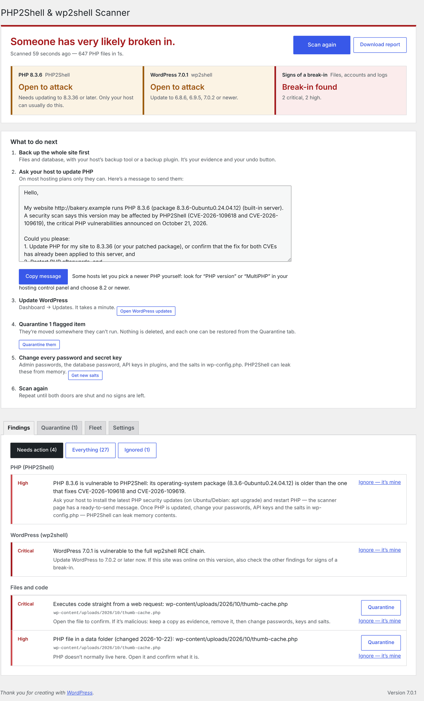
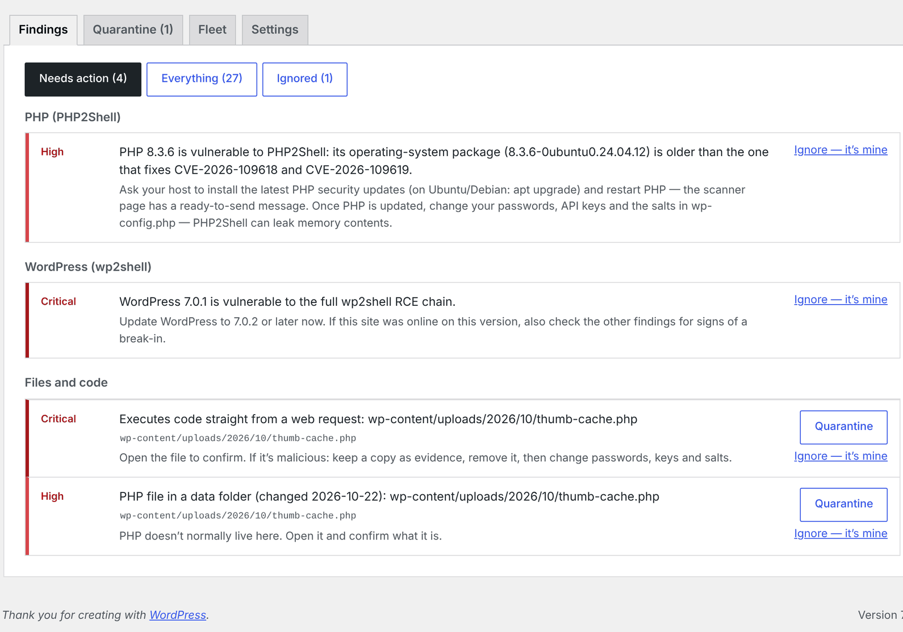
</p>

From then on it **scans automatically once a week** and **emails you** only if something serious and new turns up.

> [!TIP]
> **Multisite?** Go to **Network Admin → Plugins**, upload, and choose **Network Activate**. The scanner lives under **Network Admin → Settings → PHP2Shell Scanner** and covers the whole network.

> [!WARNING]
> Use the download link above — **not** GitHub's green **Code → Download ZIP** button. That one is the raw source code; it works, but the release zip is the one that can check its own files for tampering.

**No "Upload Plugin" button?** Some hosts and plans don't allow plugin uploads (for example WordPress.com's lower plans, or sites with `DISALLOW_FILE_MODS`). Ask your host to install it, or to run the scan for you with [WP-CLI](#13-wp-cli-reference).

## 4. Understanding your results

Every scan ends with one of these results:

| Result | What it means | What to do |
|---|---|---|
| 🟢 **No signs of PHP2Shell or wp2shell** | PHP and WordPress are patched and no traces of an attack were found. | Nothing. Keep weekly scans on. |
| 🟡 **Needs review** | A few things to confirm, none alarming on their own — e.g. *"PHP looks old but may be an OS package — ask your host"*. | Read them; **Ignore** what you've confirmed. |
| 🟠 **Vulnerable — PHP needs updating** | No signs of a break-in, but your server's PHP can be attacked through PHP2Shell. | Send your host the [ready-made message](#5-getting-your-host-to-update-php). |
| 🟠 **Vulnerable — update WordPress** | No signs of a break-in, but your WordPress can be attacked through wp2shell. | Click **Go to WordPress updates**. |
| 🔴 **Suspicious** | Something needs a closer look today — e.g. an unknown admin, PHP in your uploads folder, PHP2Shell traces in the error log. | Check every **High** finding. |
| 🚨 **Compromised** | Strong evidence of an attack — e.g. a known webshell. | Follow [If your site is compromised](#9-if-your-site-is-compromised). |

How the result is decided:

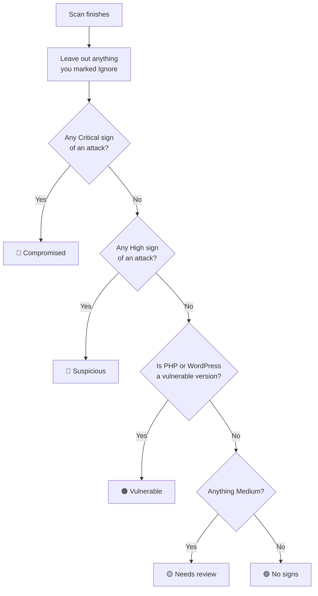

An old PHP or WordPress version on its own is never reported as *Compromised* — being vulnerable isn't the same as being hacked.

Each finding has a **severity**:

| Severity | Meaning | Examples |
|---|---|---|
| **Critical** | Almost certainly malicious (or PHP that will never be fixed) | A known webshell; a `wp2shell_…` plugin; a modified file of this scanner; PHP 7.3 |
| **High** | Very likely bad — check today | Unpatched PHP; recent PHP in `uploads/`; an unknown admin; a burst of PHP2Shell errors in the log |
| **Medium** | Possibly bad, often innocent | Old-looking PHP from an OS package; a must-use plugin changed recently; a role with admin powers |
| **Low** | Usually normal, listed so you can confirm | Plugins or themes updated since July 17; `wp-config.php` edited |
| **Info** | Just information | "PHP 8.4.27 includes the PHP2Shell fix"; which temporary protections are on |

## 5. Getting your host to update PHP

Most site owners can't update PHP themselves. When PHP needs attention, the scanner shows a box called **"Your host needs to update PHP"** with a ready-made support message that already includes your site address, PHP version and the CVE numbers. Click **Copy message** and paste it into a support ticket or live chat.

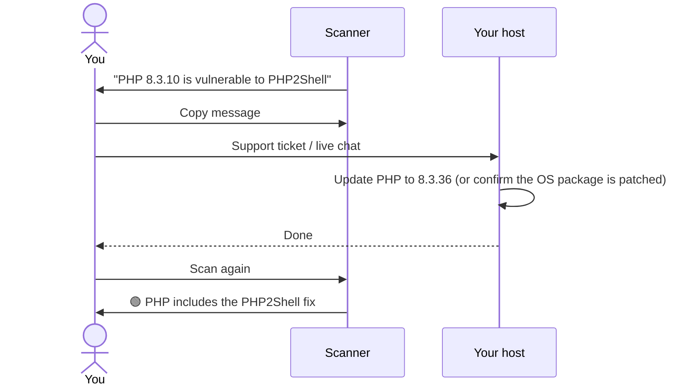

**Can I do it myself?** On many hosts, yes: look in your hosting control panel for **"PHP version"**, **"Select PHP Version"** or **"MultiPHP Manager"** (cPanel) and choose **8.2 or newer**. Test your site afterwards — very old plugins and themes may not work on newer PHP.

**Temporary protections** your host can set in `php.ini` until PHP is updated (the scanner shows which ones are on):

| Setting | Protects against | Note |
|---|---|---|
| `session.upload_progress.enabled = 0` | CVE-2026-109619 | Rarely needed by WordPress sites |
| `memory_limit = -1` | CVE-2026-109618 | Must be enforced so sites can't override it (`php_admin_value[memory_limit] = -1` in the PHP-FPM pool) |
| `fatal_error_backtraces = 0` | CVE-2026-109619, PHP 8.5 only | |
| Low `post_max_size` and `max_input_nesting_level` | CVE-2026-109618 | Limits how big and deep a form submission can be |
| `pm.max_requests = 1` (PHP-FPM) | Both | Each worker handles one request, so no leftover state is reused; costs performance |
| No `RLIMIT_AS` / `RLIMIT_DATA` limits on PHP | CVE-2026-109618 | Operating-system memory limits can trigger the bug too |

These reduce the risk; they don't remove it — security firms have shown attacks working with them in place. PHP must be restarted after changing them.

## 6. What it checks

### PHP2Shell

| Check | What it looks for | Severity |
|---|---|---|
| **PHP version** | The version your **website** runs — not just the command line's — against the fixed releases | Critical / High / Medium → *Vulnerable* or *Needs review* |
| **OS packages** | The installed Ubuntu/Debian package version against the first fixed build; other distributions that may carry the fix without a new version number | High (known-unfixed package) · Info (fixed package) · Medium ("ask your host") |
| **Build date** | PHP compiled after the fix was published (October 21, 2026) | Medium ("probably patched — confirm") |
| **Riskiest setup** | Apache `mod_php`, which researchers rate highest-risk | Noted in the finding |
| **Temporary protections** | `session.upload_progress.enabled`, `memory_limit`, `fatal_error_backtraces`, `post_max_size`, `max_input_nesting_level`. They make attacks **harder, not impossible** — only a patched PHP fixes it | Info |
| **PHP history** | Whether this site ran an unpatched PHP **after October 17, 2026**, even if it's patched now | Medium — change your passwords and keys |
| **PHP error log** | `Allowed memory size … exhausted … in Unknown on line 0` (out-of-memory before any script ran — the tell-tale sign), `Maximum execution time … exceeded in Unknown on line 0`, `Failed to decode session object`, worker crashes (`SIGSEGV`, heap corruption) since October 17 | Medium; **High** for bursts or crashes |
| | Out-of-memory errors even though `memory_limit = -1` (they should be impossible) | High |
| **Access log** | Bursts of POST requests answered with HTTP 500/502 from one address since October 17 | Medium (a lead, not proof) |
| | The public exploit and scanner tools (`php2shell-scan`, `php2shell-verify`, `JACKALPOC`) or their payload server | High |
| | Addresses publicly reported attacking PHP2Shell | Medium |
| **Temp folders** | A file called `nfs` in `/tmp` (the reported second stage); critical if it matches a known malware hash | High / Critical |
| | Programs (ELF files) in `/dev/shm`, or in `/tmp` since October 17; PHP files written to `/tmp` since October 17 | High / Medium |
| **Server persistence** | `/etc/ld.so.preload` loading a library into every program (a rootkit favourite) | High |
| **PHP sessions** | Session files containing PHP code (written by an attack, then included) | High |

> [!NOTE]
> Patched PHP 8.4.27 and 8.5.12 log **"Failed to decode session object"** more often than before ([php-src #24493](https://github.com/php/php-src/issues/24493)). On a patched PHP the scanner treats that message as information only, not as a sign of attack.

### wp2shell

| Check | What it looks for | Severity |
|---|---|---|
| **WordPress version** | 6.8 – 6.8.5, 6.9 – 6.9.4, 7.0 – 7.0.1 | Critical / High → *Vulnerable* |
| **Exploit plugins** | `wp2shell_<hex>`, fake **CMSmap**, fake **WP Static Cache Helper**, `gg-` REST shells | Critical / High |
| **Exploit leftovers** | `wp2shell_*.zip`, `wp2shell_<hex>` staging folders, `temp-write-test-*` probes | Critical / High |
| | `temp-write-test-…` files WordPress itself made (the date is in the name): before July 17, 2026 → harmless leftover; after → worth a look | Low / Medium |
| **REST backdoor** | The `morning/v1` namespace | Critical |
| **Known files** | SHA-1 hashes of published webshells | Critical |
| **Access log** | Successful (200/207) batch-API requests (even URL-encoded), exploit-tool user agents, attacker IPs, plugin uploads, admin enumeration | Critical → Medium |

### What either attack leaves behind

| Check | What it looks for | Severity |
|---|---|---|
| **Webshell code** (whole site) | Code run straight from a request (`eval`, `assert`, `system`, `passthru`…), functions named by the request (`$_GET['f'](…)`), packed `eval(gzuncompress(base64_decode(…)))`, large base64 payloads, split `${'_P'.'OST'}`, `create_function` with request input, including images as PHP, writing request data to disk, REST endpoints that run shell commands | Critical / High |
| | Request input + decoder + `eval` in one small file (some legitimate plugins do this) | Medium |
| **PHP where it doesn't belong** | PHP in `uploads/`, `cache/`, `upgrade/`, or loose in `wp-content/` — **High** if changed since July 17, *Medium* if older, *Low* if it can't be run directly | High / Medium / Low |
| **Images with PHP inside** | `<?php` hidden in uploaded `.jpg`/`.png`/`.gif`… files | High |
| **Hidden PHP** | PHP files whose names start with a dot — in the site root or `wp-content` | High / Medium |
| **PHP loaded into every page** | `auto_prepend_file` / `auto_append_file` in `.user.ini`, `.htaccess` or `php.ini` (Wordfence's firewall is recognised) | High |
| **Uploads `.htaccess`** | Lines that make PHP executable in uploads (Wordfence's protective rules are recognised) | High |
| **`wp-config.php`** | Webshell code in it; edits since July 17 | Critical / Low |
| **Administrators** | Admins created since July 17 (the one created at site setup is recognised) | High |
| | Existing or backdated accounts that **became** admins since the previous scan | High |
| | Application passwords added to admins since July 17 | Medium |
| **Roles** | Non-admin roles given admin powers (`install_plugins`, `edit_plugins`, `promote_users`…) | Medium |
| **Must-use plugins** | Added or changed since July 17 (known host files only *Low*) | Medium / Low |
| **Plugins** | Folders of PHP hidden from the Plugins screen; loose single-file plugins; plugins updated since July 17 | Medium / Low |
| **WordPress core** | Files that differ from wordpress.org's checksums; unknown PHP in `wp-admin/`, `wp-includes/` or the site root (old leftovers from manual updates are only *Low*) | High / Medium / Low |
| **This scanner itself** | Every file checked against the official release's fingerprints — attackers like to blind security tools | Critical / High |

**Built not to cry wolf.** Every release is tested against WordPress core and some of the most-installed plugins — WooCommerce, Yoast SEO, Elementor, Jetpack, Contact Form 7, WP Super Cache, over 16,000 PHP files — and must produce **zero** High or Critical matches. Common legitimate files (cache plugins, Wordfence, Performance Lab, host must-use plugins, "Silence is golden" placeholders, WordPress's own update backups) are recognised.

## 7. Settings, automatic scans and email alerts

All settings are on the scanner page (**Tools → PHP2Shell Scanner**, right-hand box):

| Setting | Default | What it does |
|---|---|---|
| **Automatic scans** | Weekly | Off, Daily or Weekly. The first run happens within an hour of activating. |
| **Email me when an automatic scan finds something new** | On | Emails only when a scheduled scan finds a **new** High/Critical problem, or the site becomes vulnerable. You won't get the same alert twice. |
| **Alert email address** | Site admin email | Where alerts go. |
| **Verify core files against wordpress.org** | On | Downloads the official checksums for your version (cached for a day). |
| **PHP error log** *(Server logs)* | Detected automatically | Where PHP2Shell attempts show up. Leave empty to use the log PHP reports, plus WordPress's `debug.log`. |
| **Web server access log** *(Server logs)* | *(empty)* | Optional. Lets scans spot attack traffic. See [Finding your logs](#15-finding-your-logs). |

The bottom of the box shows the **PHP your website runs** (version, server type, operating system), as seen by the scanner.

You'll also see results:
- in a **red notice** across the admin area when the result is *Compromised*, *Suspicious* or *Vulnerable* (dismissible; it comes back only if a later scan is still bad),
- under **Tools → Site Health**, which also warns when the last clean scan is out of date.

How a scheduled scan runs on a host with short time limits:

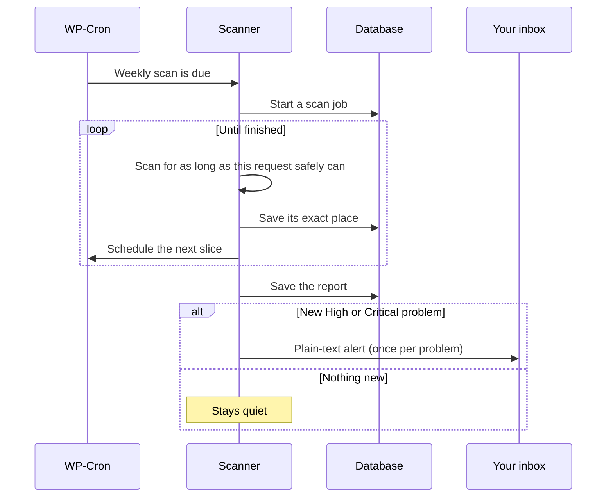

> [!NOTE]
> WordPress's built-in scheduler only runs when someone visits the site. On a very quiet site a scheduled scan may take a while — it always picks up where it left off, and is only abandoned after a full day with no progress. With a real server cron (`DISABLE_WP_CRON`), scans run in bigger slices.

## 8. Ignoring things that are yours

If a finding is something you know about — your own admin account, your host's must-use plugin, a PHP version your host confirmed is patched — click **Ignore** next to it.

- Ignored findings no longer count toward the result and never trigger an email.
- They're kept in an **"ignored findings"** list at the bottom, where **Restore** brings them back.
- A finding stays ignored when only a date or count in its text changes (e.g. your host updates their must-use plugin again).
- **If an ignored file changes, it's flagged again** — so an attacker can't hide inside something you once approved.
- The ignore list is **signed** with your site's secret keys from `wp-config.php`, so an attacker who only got into the database can't quietly add their own files to it.
- From WP-CLI: `wp php2shell ignore <id>` and `wp php2shell ignore <id> --undo`.

> [!CAUTION]
> Only ignore things you're sure about. If you're unsure, ask your developer or host — or [open an issue](https://github.com/CptNope/PHP2Shell-WP-scanner/issues) describing what was flagged (don't post passwords or full file contents).

## 9. If your site is compromised

Don't panic, and don't start deleting things yet. Work through these steps in order:

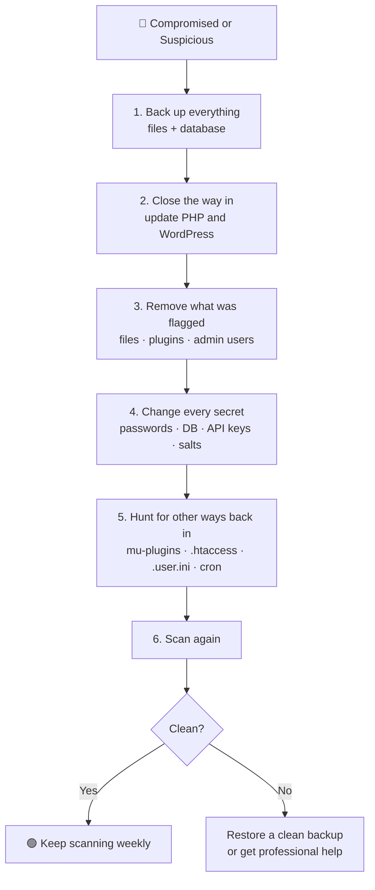

| Step | How |
|---|---|
| **1. Back up** | Use your host's backup tool or a backup plugin to copy files **and** database. It's your evidence and your undo button. |
| **2. Close the way in** | **PHP:** have your host update it (see [section 5](#5-getting-your-host-to-update-php)). **WordPress:** **Dashboard → Updates**. Update all plugins and themes too. |
| **3. Remove what was flagged** | Delete flagged plugins on the **Plugins** screen; flagged files with your host's file manager or SFTP; unknown admins under **Users** (assign their content to yourself). For modified core files use **Dashboard → Updates → Re-install**. If *this scanner's* files were modified, delete and reinstall it from the release. |
| **4. Change every secret** | PHP2Shell can leak memory, so assume anything that passed through PHP is known: reset **every** admin password; revoke unknown application passwords (**Users → Profile**); change the **database password** (hosting panel + `wp-config.php`); regenerate **API keys** stored in plugins (payment, email, backup, CDN…); replace the **salts** in `wp-config.php` with fresh ones from the [WordPress salt generator](https://api.wordpress.org/secret-key/1.1/salt/) (this logs everyone out). |
| **5. Look for other ways back in** | `wp-content/mu-plugins/`, every `.htaccess` and `.user.ini`, scheduled tasks (a plugin such as WP Crontrol lists them), your hosting panel's cron jobs, FTP/SFTP and SSH accounts. |
| **6. Scan again** | Click **Scan again** until the result is clean. |

### One-click fixes

For the most common clean-up jobs you don't need a file manager. Next to a finding you'll see a button when there's a safe fix:

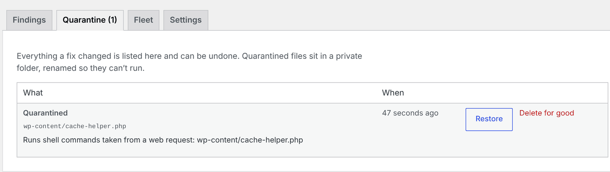

| Button | When it appears | What it does | Undo |
|---|---|---|---|
| **Quarantine** | A flagged file (webshell, PHP in uploads, a modified file) rated Medium or worse | Moves it into a private, locked quarantine folder in `wp-content` and renames it (no `.php` left anywhere in the name) so it can never run | **Restore** puts it back exactly where it was |
| **Quarantine plugin** | A malicious or suspicious plugin folder | Moves the whole folder into quarantine (WordPress deactivates it) | **Restore** |
| **Remove admin rights** | An unknown or newly promoted administrator (never you) | Makes them a Subscriber on every site, revokes Super Admin, logs them out everywhere | **Undo** gives the role back |
| **Quarantine them all** | Several critical/high file findings | Applies every file fix in one go (asks first) | Each one can be restored |

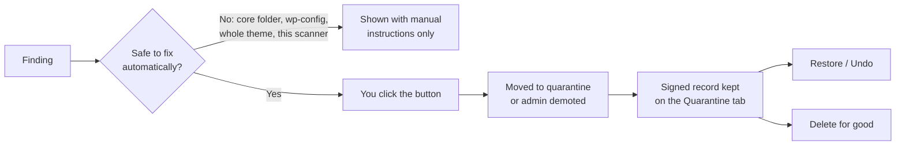

Safety rules:

- **Scans never change anything** — only a button you click (or `wp php2shell fix`) does.
- It refuses to touch WordPress core folders and root files (`wp-login.php`, `xmlrpc.php`…), `wp-config.php`, the site's `.htaccess` and `.user.ini`, the drop-ins (`db.php`, `object-cache.php`, `advanced-cache.php`, `sunrise.php`), the root of `wp-content`, `plugins`, `themes`, `uploads` or `mu-plugins`, a whole theme, or this scanner's own files. Modified core files are left to **Dashboard → Updates → Re-install**.
- It only moves **the file the scan saw**: if the file changed since (different contents), or was swapped for a link, it refuses and asks you to scan again. Restoring refuses too if the original folder has been replaced by a link.
- It never removes the rights of the **last administrator**.
- Every other finding about a quarantined file counts as handled; if a webshell is dropped again at the same path, it needs action again.
- It respects `DISALLOW_FILE_MODS` — if your site forbids file changes, the buttons don't appear.
- Each fix record is signed with your site's secret keys, so an attacker can't plant a fake "restore" that moves a file somewhere else.
- Quarantined files are deleted when you uninstall the plugin, or individually from the **Quarantine** tab.

> [!TIP]
> Not comfortable doing this yourself? Your host's support team or a WordPress security service can clean the site — many for a fixed fee. Give them the **Download report (JSON)** file; it lists everything found.

## 10. Updating the plugin

The plugin **updates itself** from this GitHub repository, through the normal WordPress update screen.

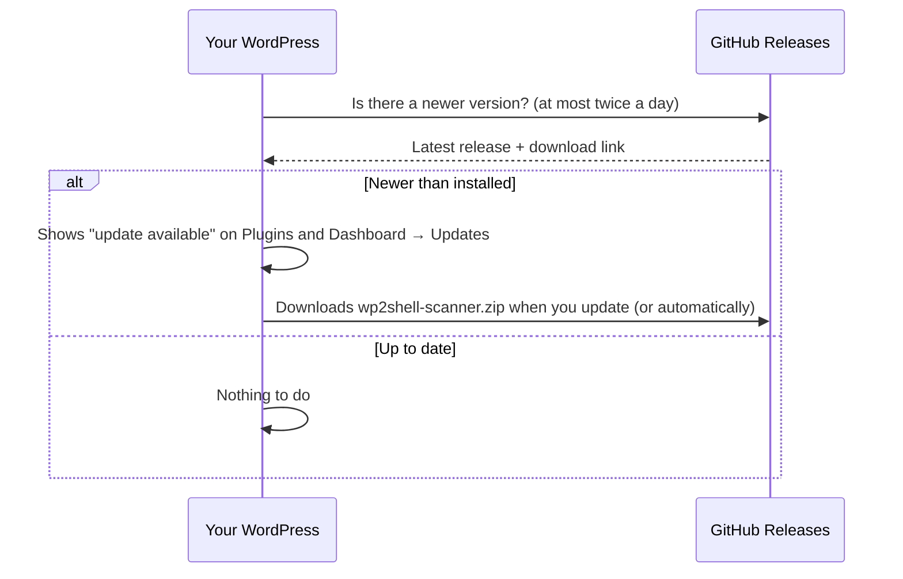

- Click **Update now** when WordPress offers it — or **Enable auto-updates** on the Plugins screen (recommended: new indicators are added as attacks evolve).
- Updates only come from this repository's official releases. The plugin declares its own update source, so a different plugin with the same folder name elsewhere can never replace it.
- Manual update: upload the latest zip under **Plugins → Add New Plugin → Upload Plugin** and choose **Replace current with uploaded**.

## 11. Troubleshooting

| Problem | Likely cause | Fix |
|---|---|---|
| No **Upload Plugin** button | Host or plan blocks uploads, or `DISALLOW_FILE_MODS` | Ask your host to install it, or use WP-CLI |
| "PHP … is vulnerable" but my host says it's patched | Your host uses OS packages that keep the old version number | If they confirm both CVEs are fixed, click **Ignore** on that finding |
| PHP version shown is "command line" | The scan ran from WP-CLI and the dashboard hasn't been opened since installing | Open the scanner page once in the dashboard; the website's PHP is then remembered |
| Progress bar stops with "HTTP 500/503/504" | Host killed the request, or a temporary hiccup | It retries three times. Click **Scan again** — it continues where it stopped. |
| "Waiting for another scan in progress…" | Another tab or a scheduled scan is working on the same scan | Normal — they take turns |
| "Your session expired" | You were logged out | Reload the page and log in again |
| "Couldn't get core checksums" | Server can't reach wordpress.org | Harmless; other checks still ran |
| "Log file not readable" | Wrong path, or PHP isn't allowed to read it (`open_basedir`, permissions) | See [Finding your logs](#15-finding-your-logs), or leave the setting empty |
| Lots of **Low** findings about plugin/theme updates | Things were updated after July 17 | Expected. Glance at the names; **Ignore** them. |
| `it-api.php` in the site root | Your host's one-click installer (Installatron, used by IONOS and others) | Shown as information since 1.3.2. Safe to leave; it deletes itself after a while |
| A hidden `.ht….appconfig.php` (or similar) file | A plugin storing a key or settings in a file that can only answer "404" | Low since 1.3.2. Check its date against when you installed plugins; quarantining it is harmless |
| `wp-includes/collaboration/…` files flagged | Left over from WordPress 7.0 (later versions removed them) | Low since 1.3.1 if they match the official files; safe to delete |
| `temp-write-test-…` files in `wp-content` | WordPress's own write check, not cleaned up | Low since 1.3.1 when they predate the attacks; safe to delete |
| An admin you know is flagged | Created (or promoted) after July 17 / since the last scan | If it's yours, click **Ignore** |
| "A role has administrator powers" | A plugin (e.g. a membership or shop plugin) changed a role | If you trust that plugin, click **Ignore** |
| Weekly scans don't seem to run | Quiet site, or WP-Cron disabled with no server cron | Visit the site now and then, or ask your host for a real cron |
| No alert emails arrive | Your site can't send email | Install an SMTP plugin; check the alert address |
| "The … stopped early: …" info finding | One check hit an unexpected error; the rest still ran | Please [open an issue](https://github.com/CptNope/PHP2Shell-WP-scanner/issues) with that message |

## 12. FAQ

<details><summary><b>Can a WordPress plugin really detect a bug in PHP?</b></summary>

It can tell whether your PHP version is vulnerable, which temporary protections are on, and whether the traces researchers describe appear in your logs — and it can find the backdoors an attacker leaves afterwards. It **can't** see inside PHP's memory or stop the attack; only updating PHP does that.
</details>

<details><summary><b>Will it change, quarantine or delete anything?</b></summary>

Scans never do. Changes happen only when you click a fix button (or run `wp php2shell fix`): a file is moved into quarantine and renamed so it can't run, or an admin is made a Subscriber. Every fix can be undone from the **Quarantine** tab. See [One-click fixes](#one-click-fixes).
</details>

<details><summary><b>Will it slow my site down?</b></summary>

No. It does nothing for visitors. Scans run only when you click **Scan** or on the weekly schedule, in short slices.
</details>

<details><summary><b>It says "Vulnerable". Was I hacked?</b></summary>

Not necessarily. "Vulnerable" means no evidence of a break-in was found, but your PHP or WordPress can be attacked. Get it updated, then scan again.
</details>

<details><summary><b>It says "No signs". Am I definitely safe?</b></summary>

It means none of the known traces were found. Attackers can rename and rewrite things, and PHP2Shell's memory leak leaves nothing on disk, so no scanner can promise 100%. If your site ran a vulnerable PHP after October 17, 2026, change your passwords and keys anyway.
</details>

<details><summary><b>Does it work alongside Wordfence / Sucuri / Solid Security / my host's scanner?</b></summary>

Yes. It's narrowly focused on these two attacks and recognises those tools' files. It complements them rather than replacing them.
</details>

<details><summary><b>Does it send my data anywhere?</b></summary>

No. See [Privacy and stored data](#18-privacy-and-stored-data).
</details>

<details><summary><b>Can I remove it once I'm sure my site is clean?</b></summary>

Yes — deactivate and delete it; it removes everything it stored. Keeping it gives you weekly checks and alerts as new indicators are added.
</details>

<details><summary><b>Why is the plugin file called wp2shell-scanner?</b></summary>

Version 1.0 only covered wp2shell. The internal name stayed the same so existing installs keep updating automatically.
</details>

---

## 13. WP-CLI reference

Everything the dashboard does is available from the command line. The command is `wp php2shell` (the 1.0 name `wp wp2shell` still works).

| Command | What it does |
|---|---|
| `wp php2shell scan` | Run a full scan now and print the findings |
| `wp php2shell status` | Show the last result without scanning again |
| `wp php2shell ignore <id>…` | Mark finding(s) as ignored (`--undo` to restore) |
| `wp php2shell fix <id>…` | Apply the one-click fix for finding(s); `--all-critical` fixes every critical/high file finding; `--yes` skips the question |
| `wp php2shell quarantine list` | List quarantined items and other fixes (`--format=json`) |
| `wp php2shell quarantine restore <id>` | Undo a fix: restore a file/plugin, or give admin rights back |
| `wp php2shell quarantine delete <id>` | Delete a quarantined item for good |
| `wp php2shell fleet hub` | Make this site the fleet hub and print its key |
| `wp php2shell fleet join <hub-url> <key>` | Report this site's results to a hub after every scan |
| `wp php2shell fleet send` / `status` / `leave` | Report now / show fleet status / stop reporting |
| `wp php2shell fleet list` | On the hub: every site's latest result (`--format=csv` or `json`) |
| `wp php2shell fleet rescan [<site>]` | On the hub: ask one site, or all, to scan at their next hourly check-in |
| `wp php2shell fleet alerts [--email=…] [--webhook=…] [--stale-days=…]` | On the hub: show or change alert settings (`off` turns one off) |
| `wp php2shell fleet test-alert` | On the hub: send a test alert now |
| `wp php2shell fleet check-in` | On a member: check in with the hub now (starts a scan if one was requested) |

**`wp php2shell scan` options**

| Option | Default | Meaning |
|---|---|---|
| `--log=<path>` | The path saved in settings | Access log to check (`.gz` works) |
| `--error-log=<path>` | The setting, then the log PHP reports | PHP error log to check for PHP2Shell traces (`.gz` works) |
| `--skip-core` | off | Don't verify core files against wordpress.org |
| `--min=<severity>` | `low` | Hide findings below `info`, `low`, `medium`, `high` or `critical` |
| `--format=<format>` | `table` | `table`, `json`, `csv`, `yaml` or `summary` (one line) |
| `--include-ignored` | off | Also list findings marked as ignored |

> [!NOTE]
> WP-CLI often runs a **different PHP** from your website. For the PHP2Shell check, the scanner uses the website's PHP as last recorded by the dashboard (or by a scheduled scan). If it has never seen it, it checks the command-line PHP and says so.

**Exit codes** — handy for scripts and monitoring:

| Code | Result |
|---|---|
| `0` | No signs, or Needs review |
| `1` | Vulnerable, or Suspicious |
| `2` | Compromised |

**Examples**

```bash
wp php2shell scan                                          # human-readable table
wp php2shell scan --min=high                               # only what needs action
wp php2shell scan --error-log=/var/log/php-fpm/www-error.log --log=/var/log/nginx/access.log
wp php2shell scan --format=json > php2shell-report.json    # full report
wp php2shell scan --format=summary                         # VULNERABLE  https://example.com  wp 7.1.2  php 8.3.10  critical:0 high:1 medium:0
wp php2shell scan --format=json | jq -r '.findings[] | select(.severity=="critical") | .message'
wp php2shell status --format=table
wp php2shell ignore 3f9a1c2b7d10
wp php2shell fix 3f9a1c2b7d10                              # quarantine one flagged file
wp php2shell fix --all-critical --yes                      # quarantine everything critical/high
wp php2shell quarantine list
wp php2shell quarantine restore k3j9x0p2q7ab
```

**Install with WP-CLI**

```bash
wp plugin install https://github.com/CptNope/PHP2Shell-WP-scanner/releases/latest/download/wp2shell-scanner.zip --activate
# Multisite: add --network
```

## 14. Scanning many sites

### The fleet dashboard (easiest)

Pick one of your sites as the **hub**. Every other site sends its result there after each scan, and the hub's **Fleet** tab shows all of them on one screen — worst first, with stale sites (no report in 15 days) marked.

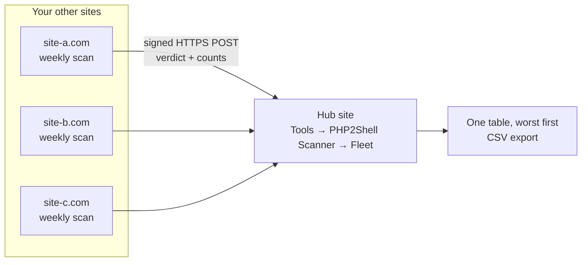

1. On the hub: **Fleet → This site is the hub → Save**. Copy the **fleet key**.
2. On each other site: **Fleet → Report to a hub**, paste the hub address and key, **Save**, then **Send now**. Or from the command line on all of them at once:

```bash
wp php2shell fleet hub                                    # on the hub — prints the key
wp @all php2shell fleet join https://hub.example.com KEY  # on every other site
wp @all php2shell scan --format=summary                   # each scan reports in
wp php2shell fleet list --format=csv > fleet.csv          # on the hub
```

What a member sends (and nothing else):

| Sent | Not sent |
|---|---|
| Site address and name, link to its scanner page | File contents, logs, database data |
| Verdict, WordPress and PHP version, PHP type | Usernames' e-mail addresses (stripped) |
| Number of findings per severity | Low/info findings |
| The text of up to 10 critical/high findings | Anything at all if fleet mode is off (the default) |

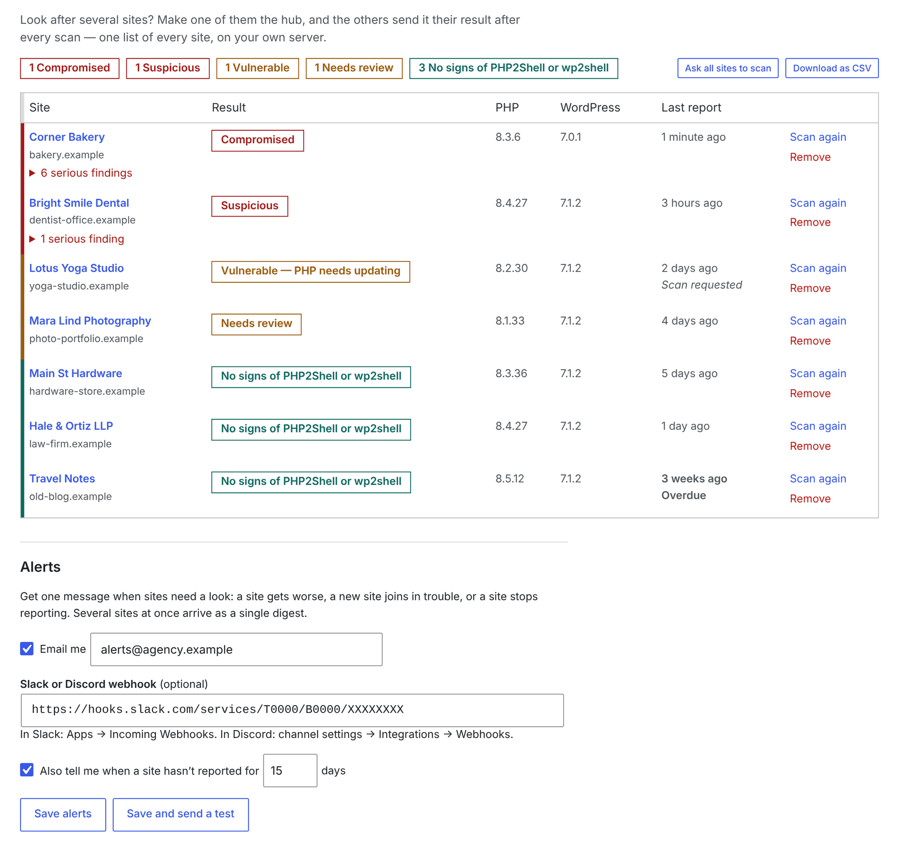

**How it's protected**

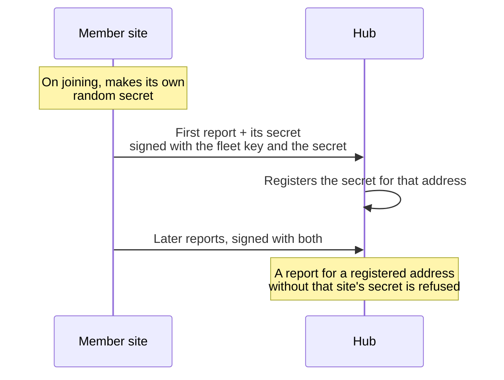

- **Two signatures on every report:** the shared fleet key proves it's one of *your* sites; the site's own secret, registered with its first report, proves *which* one. So someone who steals the fleet key from one member can't overwrite another site's row, and nobody can report for the hub's own address.
- Reports more than 10 minutes old or more than a minute "in the future" are refused, as is anything older than what the hub already has.
- Everything received is cleaned before it's stored or shown; a member's "open scanner" link is only kept if it's on that member's own address.
- Reinstalled the scanner on a member? Click **Remove** on its row on the hub, then report again — it registers afresh. **Empty the list** does that for every site.
- If the fleet key leaks, **Make a new key** on the hub and re-join the members. Use HTTPS for the hub — the screen warns you if you don't.
- Members only send to public addresses. For a hub on a private network (`10.x`, `192.168.x`, `localhost`), add `define( 'WP2SS_FLEET_PRIVATE_HUB', true );` to each member's `wp-config.php`.
- To keep the key out of your shell history and process list: `WP2SS_FLEET_KEY=… wp php2shell fleet join https://hub.example.com`, or `… fleet join https://hub.example.com - < keyfile`.

### Fleet alerts

The hub can tell you when something changes, so you don't have to keep checking:

| You get a message when | Example |
|---|---|
| A site gets worse | *Corner Bakery is now “Compromised” (was “No signs”)* — with the new findings |
| A site that's already in trouble has new serious findings | *Bright Smile Dental has new serious findings* |
| A new site joins already in trouble | *Lotus Yoga Studio joined the fleet: “Vulnerable — PHP needs updating”* |
| A site stops reporting (default: 15 days, adjustable) | *Travel Notes hasn't reported for 16 days* |
| An overdue site reports again | *Travel Notes is reporting again* |

- **Email**, a **Slack or Discord webhook**, or both. Set them on the hub's **Fleet → Alerts**, then click **Save and send a test**.
- Changes are collected for two minutes and sent as **one digest**, so 50 sites scanning at once send one message.
- Messages are plain text; anything that could ping a channel (`@everyone`, `<!channel>`) or add links is neutralised, since site names and findings come from other sites.

```bash
wp php2shell fleet alerts --email=ops@agency.example --webhook=https://hooks.slack.com/services/… --stale-days=10
wp php2shell fleet test-alert
```

### Asking sites to scan again

**Scan again** on a row (or **Ask all sites to scan**) asks members to scan at their next check-in. Members on 1.3 or later check in with the hub **every hour**, so the new result arrives within about an hour — useful right after you've patched a server. From the command line: `wp php2shell fleet rescan` (all) or `wp php2shell fleet rescan https://shop.example`.

### With WP-CLI only

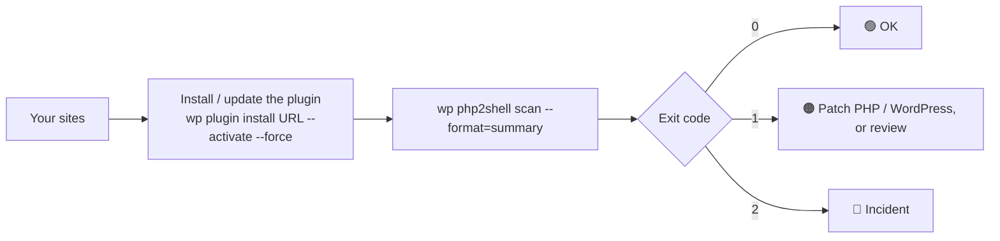

**With WP-CLI aliases** (`@all` defined in `wp-cli.yml`):

```bash
URL=https://github.com/CptNope/PHP2Shell-WP-scanner/releases/latest/download/wp2shell-scanner.zip
wp @all plugin install "$URL" --activate --force
wp @all php2shell scan --format=summary
```

**Every WordPress on one server**, flagging the bad ones:

```bash
#!/usr/bin/env bash
URL=https://github.com/CptNope/PHP2Shell-WP-scanner/releases/latest/download/wp2shell-scanner.zip
for wp in $(find /var/www /home -maxdepth 4 -name wp-config.php -printf '%h\n' 2>/dev/null); do
  wp --path="$wp" plugin install "$URL" --activate --force --quiet 2>/dev/null
  wp --path="$wp" php2shell scan --format=summary 2>/dev/null
  case $? in 2) echo "!!! COMPROMISED: $wp";; 1) echo "!   check: $wp";; esac
done
```

> Run as the user that owns each site (e.g. `sudo -u www-data …`), not as root, so file ownership doesn't change.

> [!TIP]
> **Hosts and server admins:** PHP2Shell is fixed per *server*, not per site. Check the PHP that actually serves the sites (`php-fpm -v`, or your control panel), not just `php -v`, and look at your distribution's changelog for CVE-2026-109618 / 109619 — e.g. `apt changelog php8.3-fpm | grep 1096` or `rpm -q --changelog php-fpm | grep 1096`.

**Collect JSON reports centrally**

```bash
for wp in /var/www/*/; do
  wp --path="$wp" php2shell scan --format=json > "reports/$(basename "$wp").json"
done
jq -r '[.site, .verdict, .php.version] | @tsv' reports/*.json | sort -k2
```

## 15. Finding your logs

Logs let the scanner see attack *attempts*, not just leftovers. Both are optional, and PHP must be allowed to read them — on shared hosting it often can't, and that's fine.

**PHP error log** — where PHP2Shell attempts show up. Leave the setting empty and the scanner uses the log PHP itself reports plus WordPress's `debug.log`.

| Setup | Typical location |
|---|---|
| PHP-FPM (Debian/Ubuntu) | `/var/log/php8.3-fpm.log` (pool errors), or the `error_log` set in the pool config |
| PHP-FPM (RHEL family) | `/var/log/php-fpm/www-error.log` |
| Apache mod_php | Apache's error log (below) — PHP lines are tagged `[php:error]` |
| cPanel | `error_log` files in the site folders, or `~/logs/` |
| WordPress | `wp-content/debug.log` when `WP_DEBUG_LOG` is on |

**Web server access log**

| Setup | Typical location |
|---|---|
| Apache on Debian / Ubuntu | `/var/log/apache2/access.log` · errors: `/var/log/apache2/error.log` |
| Apache on RHEL / Alma / Rocky | `/var/log/httpd/access_log` · errors: `/var/log/httpd/error_log` |
| Nginx | `/var/log/nginx/access.log` · errors: `/var/log/nginx/error.log` |
| LiteSpeed / OpenLiteSpeed | `/usr/local/lsws/logs/access.log` |
| cPanel | `~/access-logs/<your-domain>` · server-wide `/usr/local/apache/domlogs/<your-domain>` |
| Plesk | `/var/www/vhosts/<your-domain>/logs/access_log` |
| Managed WordPress hosts | Usually not readable by PHP — use the host's log viewer, or ask support |

Attacks began **October 17, 2026** — make sure the logs you check go back that far. Rotated logs (`access.log.2.gz`) work too: `wp php2shell scan --log=/var/log/nginx/access.log.2.gz`.

## 16. Hosting compatibility

| Environment | Works? | Notes |
|---|---|---|
| Shared hosting with 30-second PHP limits | ✅ | Scans run in slices of a few seconds with automatic resume |
| Managed WordPress (WP Engine, Kinsta, SiteGround, GoDaddy…) | ✅ | Hosts' own must-use plugins are recognised as low-risk |
| `DISABLE_WP_CRON` with a real server cron | ✅ | Scheduled scans use bigger slices |
| Quiet sites (WP-Cron rarely triggered) | ✅ | Scheduled scans resume across visits |
| Persistent object cache (Redis, Memcached) | ✅ | Scan state is read fresh each slice |
| Multisite | ✅ | One network-wide scan and report; admins on every site |
| Server blocks outbound requests | ✅ | Core-checksum and self-check against GitHub are skipped with a note |
| `open_basedir` restrictions | ✅ | Unreadable paths are counted and skipped |
| Symlinked plugin or upload folders (Bedrock, Capistrano, Pantheon) | ✅ | Followed once each; loops detected |
| Plugin / upload folders outside `wp-content` | ✅ | Scanned too |
| Huge folders (100,000+ files) | ✅ | Read one entry at a time; the scan can pause mid-folder |
| File names in old encodings (Latin-1) | ✅ | Handled without stalling the scan |
| Windows / IIS | ⚠️ | Should work (paths are normalised) but isn't tested in CI |
| PHP 7.0 → 8.5 · WordPress 6.0 → 7.x | ✅ | Tested in CI |

## 17. How it works inside

**The files**

| File | Job |
|---|---|
| `wp2shell-scanner.php` | Plugin header, constants, loads everything |
| `includes/signatures.php` | **All indicators** — fixed PHP and WordPress versions, log patterns, hashes, IPs, code patterns. Easy to review and extend. |
| `includes/class-scanner.php` | The scan engine: resumable job, locking, every check |
| `includes/class-env.php` | Records the **website's** PHP (version, server type, php.ini settings, history) |
| `includes/class-admin.php` | The admin page, AJAX scanning, host message, ignore list, notice |
| `includes/class-cron.php` | Scheduled scans and email alerts |
| `includes/class-settings.php` | Settings storage |
| `includes/class-site-health.php` | Tools → Site Health test |
| `includes/class-updater.php` | Updates from GitHub releases |
| `includes/class-cli.php` | WP-CLI commands |
| `assets/admin.js`, `assets/admin.css` | Progress bar, buttons (no jQuery, no external files) |
| `uninstall.php` | Removes everything on delete |
| `manifest.json` *(release zip only)* | SHA-256 fingerprints of every file, for the self-check |

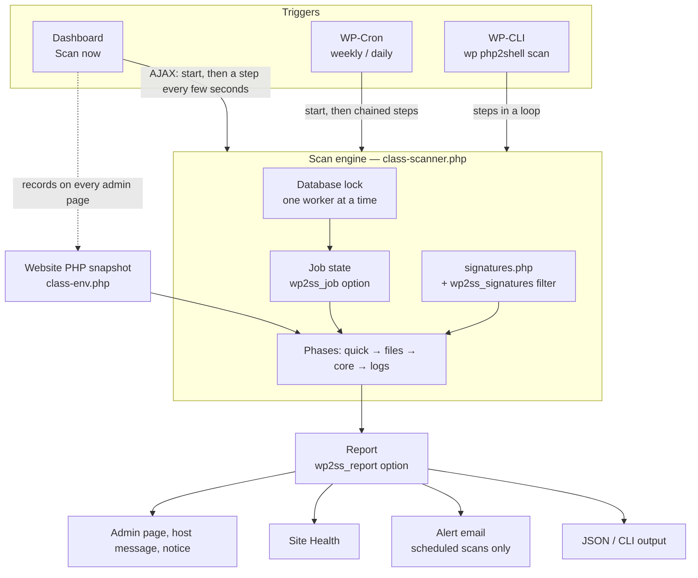

**A scan is a resumable job.** Instead of one long request (which cheap hosts kill after 30 seconds), the scanner works for a few seconds, saves exactly where it is — down to the position inside a folder — and continues on the next request.

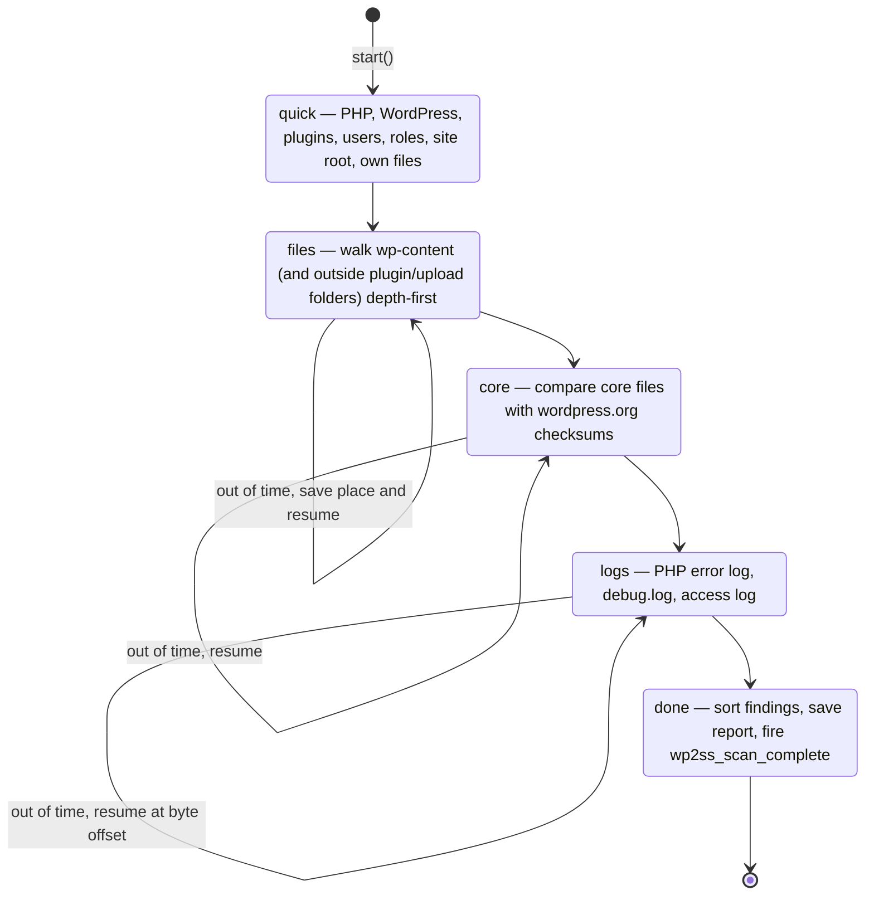

**One worker at a time.** Each slice takes a short database lock. If two browser tabs — or a tab and a scheduled scan — try to work at once, the second waits its turn. A lock left by a crashed request expires after 5 minutes, and a cancelled scan can't be written back by a slice that was still running.

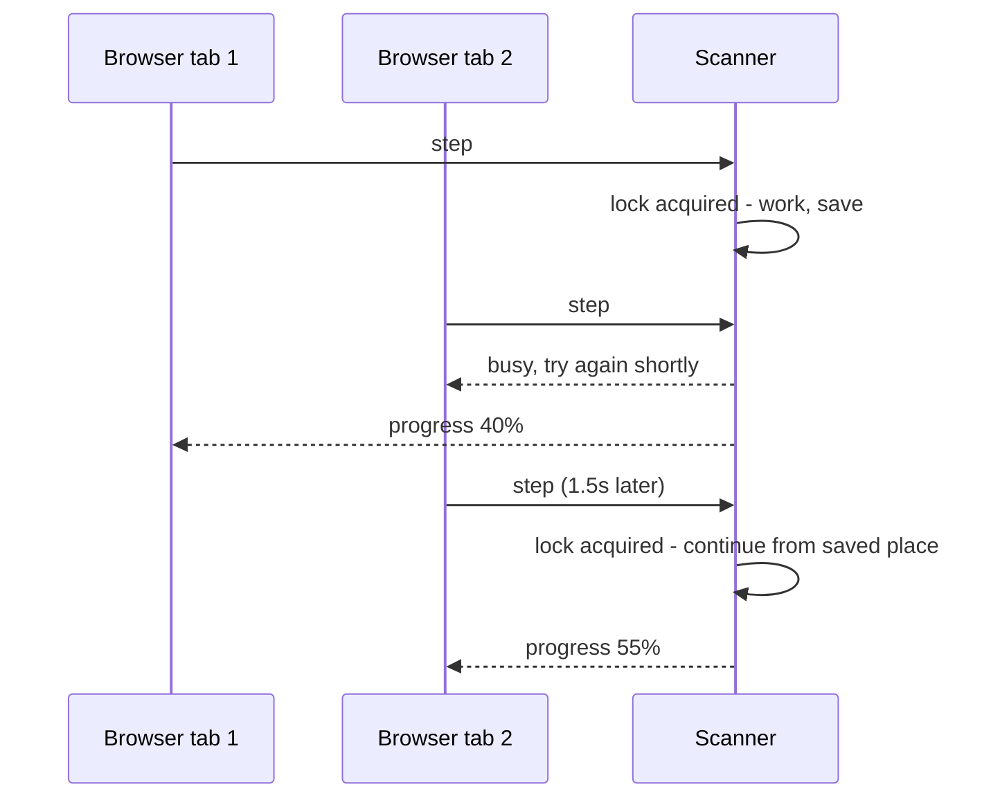

**Robustness built in**

| Situation | What the scanner does |
|---|---|
| A check throws an unexpected error | Reports it as an *Info* finding and carries on |
| A step could hang (e.g. a host silently dropping connections to wordpress.org) | Attempted at most twice, then skipped with a note |
| A file can't be read | Counted as unreadable; the scan moves on |
| A PHP file over 5 MB | Hashed, and the first and last 1 MB checked (where injected code sits) |
| A folder with hundreds of thousands of files | Read entry by entry; the scan can stop mid-folder; saved state stays tiny |
| Symlinked folders | Followed once each (max 200); loops skipped |
| File names that aren't valid UTF-8 | Stored safely and shown readably — they can't stall the scan |
| The scan pauses for hours (quiet site) | Resumes; only a job with no progress for 24 hours is abandoned |
| Plugin updated mid-scan | Old-format job is discarded; a fresh one starts |
| PHP warnings printed by the host | Can't corrupt the progress bar's replies |
| A badly infected site | At most 1,000 findings stored, plus a count of the rest |
| Database-only attacker | Ignore list and admin baseline are signed with `wp-config.php` secrets; tampering is reported |
| Attacker edits this plugin | Files checked against the release fingerprints published on GitHub |

## 18. Privacy and stored data

**Nothing about your site is sent to us or any third party.** The only outside requests are:

| Request | When | Why |
|---|---|---|
| `api.wordpress.org` — core checksums | During a scan, at most once a day (cached) | To check core files are untouched. Turn off in settings. |
| `api.github.com` — latest release | At most twice a day | To offer plugin updates |
| `github.com` — the release's `manifest.json` | At most weekly (cached) | To check this plugin's own files weren't tampered with |
| `github.com` — release zip | Only when you install an update | The update itself |
| **Your own hub site** — fleet report | After each scan, only if you set up fleet mode | See [the fleet dashboard](#the-fleet-dashboard-easiest) for exactly what's sent |
| **Your own hub site** — check-in | Hourly, only on fleet members | Asks whether a new scan was requested; sends only the site address |
| **Your Slack / Discord webhook** | Only on a hub with a webhook set | Fleet alert digests |

`WP2SS_DISABLE_UPDATER` turns off all three GitHub requests.

**What it stores** (all removed when you delete the plugin):

| Name | Where | Contents |
|---|---|---|
| `wp2ss_settings` | Options | Your settings |
| `wp2ss_report` | Options | The latest report |
| `wp2ss_job` | Options | A scan in progress (deleted when it finishes) |
| `wp2ss_ignored` | Options | Findings you ignored (signed) |
| `wp2ss_env` | Options | The website's PHP version, server type, relevant php.ini settings and a short version history |
| `wp2ss_admins` | Options | Administrator user IDs at the last scan (signed) |
| `wp2ss_fixes` | Options | One-click fixes you applied, for undo (signed) |
| `wp2ss_quarantine_dir` | Options | Name of the random, locked quarantine folder in `wp-content` (the folder and its files are deleted too) |
| `wp2ss_fleet` | Options | Fleet mode, hub address and key |
| `wp2ss_fleet_sites` | Options (hub only) | Latest report from each member site (up to 1,000) |
| `wp2ss_fleet_status` | Options (members) | When the last report was sent, and any error |
| `wp2ss_fleet_pins` | Options (hub only) | Each member's registered secret |
| `wp2ss_fleet_queue` | Options (hub only) | Alerts waiting to go out in the next digest |
| `wp2ss_fleet_alerts`, `wp2ss_fleet_daily`, `wp2ss_fleet_poll` | WP-Cron | Alert digest, daily overdue check (hub), hourly check-in (members) |
| `wp2ss_lock` | Options (main site) | Short-lived lock while a slice runs |
| `wp2ss_release`, `wp2ss_core_*`, `wp2ss_manifest_*` | Transients | Cached update info, checksums and fingerprints |
| `wp2ss_dismissed` | User meta | Which report's notice you dismissed |
| `wp2ss_scheduled_scan`, `wp2ss_scan_step` | WP-Cron | Scheduled scan events |

On multisite these live in network-wide options.

## 19. Hooks, filters and constants

| Name | Type | Use |
|---|---|---|
| `wp2ss_signatures` | Filter | Add or change indicators (fixed PHP versions, code patterns, hashes, IPs, log patterns…). Receives the array from `includes/signatures.php`. |
| `wp2ss_step_budget` | Filter | Seconds of work per slice (float). Lower it on very strict hosts. |
| `wp2ss_scan_complete` | Action | Fires with `( $report, $previous_report )` when a scan finishes |
| `wp2ss_fix_applied` | Action | Fires with the fix record after a one-click fix (quarantine or admin removal) |
| `wp2ss_fix_undone` | Action | Fires with the fix record after a restore or undo |
| `wp2ss_fleet_private_hub` | Filter | Return `true` to let this member report to a hub on a private network address |
| `WP2SS_FLEET_PRIVATE_HUB` | Constant | Same as the filter, from `wp-config.php` |
| `WP2SS_DISABLE_UPDATER` | Constant | `define( 'WP2SS_DISABLE_UPDATER', true );` in `wp-config.php` stops all requests to GitHub |

**Add your own indicators**

```php
add_filter( 'wp2ss_signatures', function ( $sig ) {
    // [ severity, regex, description ]
    $sig['code'][] = array( 'high', '/my_known_bad_function\s*\(/i', 'Our internal backdoor marker' );
    $sig['sha1']['0123456789abcdef0123456789abcdef01234567'] = 'Sample from our incident';
    // If PHP ships another fix, tell the scanner about it:
    $sig['php_fixed']['8.4'] = '8.4.28';
    // …or about a newly fixed distribution package: [ prefix, first fixed build ]
    $sig['php_fixed_pkg'][] = array( '8.2.29-1~deb12u', 2 );
    return $sig;
} );
```

**Post every result to Slack**

```php
add_action( 'wp2ss_scan_complete', function ( $report ) {
    wp_remote_post( 'https://hooks.slack.com/services/XXX', array(
        'body'    => wp_json_encode( array( 'text' => "{$report['site']}: {$report['verdict']} (PHP {$report['php']['version']})" ) ),
        'headers' => array( 'Content-Type' => 'application/json' ),
    ) );
} );
```

## 20. Report format (JSON)

What **Download report (JSON)** and `wp php2shell scan --format=json` produce:

| Field | Type | Meaning |
|---|---|---|
| `id` | string | Unique ID of this scan |
| `site` | string | Site URL |
| `wp` | string | WordPress version |
| `php` | object | `version`, `sapi` (server type), `source` (`web`, `web-snapshot` or `cli`) |
| `plugin` | string | Scanner version |
| `source` | string | `manual`, `cron` or `cli` |
| `args` | object | `core`, `log`, `error_log` — what this scan was asked to do |
| `scanned` | string | Finish time, ISO 8601 UTC |
| `duration` | int | Seconds from start to finish |
| `verdict` | string | `CLEAN`, `REVIEW`, `VULNERABLE`, `SUSPICIOUS`, `COMPROMISED` |
| `stats` | object | `files`, `php_files`, `dirs`, `unreadable`, `links`, `large`, `errors` |
| `findings[]` | array | See below |
| `ignored` | array | IDs you ignored (dashboard download only) |

| `findings[]` field | Meaning |
|---|---|
| `id` | Stable 12-character ID (use with `wp php2shell ignore`) |
| `severity` | `critical`, `high`, `medium`, `low`, `info` |
| `type` | `php`, `version`, `plugin`, `mu-plugin`, `user`, `rest`, `file`, `code`, `hash`, `core`, `log`, `scan` |
| `message` | What was found |
| `advice` | What to do about it |
| `location` | File path, `user:<ID>`, `role:<name>`, `rest:<namespace>`, or empty |
| `sha1` | Fingerprint of the file, where relevant (so an ignored file that changes is flagged again) |

## 21. Development, tests and releases

```bash
# Integration tests — they plant FAKE malware files, so only use a throwaway site
tests/integration.sh /path/to/throwaway/wordpress

# False-positive check — signatures vs. legitimate code
php tests/false-positives.php /path/to/wordpress /path/to/some/plugins

# Mermaid diagrams in this README
npm i mermaid@11 jsdom && node tests/check-mermaid.mjs README.md
```

**What CI checks on every push**

| Job | What |
|---|---|
| PHP syntax | Every file on PHP 7.0 – 8.5 |
| Integration | Real WordPress + MySQL: latest WP on PHP 7.4 and 8.4; WP 7.0, 7.0.1 and 6.9.4 (vulnerable); WP 6.4 on PHP 7.0. ~90 checks: PHP2Shell version logic and log evidence, wp2shell indicators, false-positive bait (Wordfence, Performance Lab, cache plugins…), evasion (padded files, symlinks, images, odd file names, hiding in the scanner), resumable slices, locking, cancellation, crash isolation, signed ignore list, admin baseline, self-integrity, exit codes. Fails on any PHP notice. |
| False positives | Signatures vs. WordPress core, WooCommerce, Yoast SEO, Elementor, Jetpack, Contact Form 7, WP Super Cache — zero High/Critical allowed |
| Docs | Every Mermaid diagram in this README must parse |

**How a release happens**

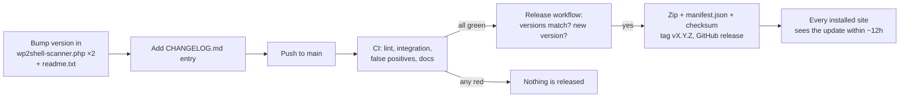

Workflow actions are pinned to exact commits. Detection rules live in [`includes/signatures.php`](includes/signatures.php) — **new indicators are very welcome**: open an issue or pull request with a link to the source.

## 22. Limits

- **PHP2Shell happens below WordPress.** The plugin can judge your PHP version and settings and look for traces and leftovers, but it can't watch PHP's memory or processes, and it can't stop the attack. Only updating PHP does.
- **Memory leaks leave no trace on disk.** If you ran a vulnerable PHP after October 17, 2026, change your secrets even if the scan is clean.
- **OS packages** can be patched without a version change. The scanner reads Debian/Ubuntu package versions and PHP's build date, but on other systems it can't always tell. Your host can.
- **One-click fixes are a first aid kit, not a full clean-up.** Quarantining what was found doesn't remove what wasn't; still change your secrets and scan again.
- **The fleet hub trusts each member about itself.** A fully compromised member can send a fake "clean" report about *itself* (it can't touch other sites' rows). A site that stops reporting shows as overdue and triggers an alert.
- **Session-file, `/tmp` and `/etc/ld.so.preload` checks** only work where PHP is allowed to look (many shared hosts block it with `open_basedir`); silence there isn't an all-clear.
- **Known indicators only.** Attackers can rename files and rewrite code, so "no signs" means no *known* indicators — not a guarantee.
- **An attacker with full control of the server** could tamper with any tool running on it, including this one. The self-check against GitHub makes that harder, not impossible. For certainty, have your host check from outside.
- It looks for these two attacks specifically. It isn't a general antivirus — keep your usual security plugin or host scanner.
- Finding texts are in English; the interface is translation-ready (`languages/wp2shell-scanner.pot`).

## 23. Security

Found a security problem **in this plugin**? Please report it privately via **Security → Report a vulnerability** on this repository — see [SECURITY.md](SECURITY.md). New indicators aren't secret; share them as a normal issue or pull request.

## 24. Sources

**PHP2Shell**
- [PHP security advisory GHSA-w8hw-w9fx-j79w (php-src)](https://github.com/php/php-src/security/advisories/GHSA-w8hw-w9fx-j79w)
- [Wiz — PHP2Shell: AI uncovers critical RCE vulnerabilities](https://www.wiz.io/blog/php2shell-php-rce)
- [Tenable — PHP2Shell FAQ](https://www.tenable.com/blog/php2shell-cve-2026-109618-cve-2026-109619-frequently-asked-questions-about-critical-php-remote)
- [Help Net Security — PHP2Shell patched, update now](https://www.helpnetsecurity.com/2026/10/21/php2shell-php-vulnerabilities-patched-cve-2026-109618-cve-2026-109619/)
- [Sansec — PHP2Shell](https://sansec.io/research/php2shell)
- [Patchstack — PHP major vulnerability alert](https://patchstack.com/articles/php-major-vulnerability-alert-10-2026/)
- [PHP2Shell detection opportunities (community gist)](https://gist.github.com/Blevene/472692937d05145d29d17dc3c6edc2a0)
- [AlmaLinux — patched PHP packages](https://almalinux.org/blog/2026-10-21-php2shell-cve-2026-109618-cve-2026-109619/)

**wp2shell**
- [Wiz Research — Exploitation in the Wild of wp2shell](https://www.wiz.io/blog/wp2shell-cve-2026-63030-cve-2026-60137)
- [Elastic Security Labs — wp2shell detection end to end](https://www.elastic.co/security-labs/blog/wp2shell-wordpress-rce-detection-elastic-defend)
- [MalwareBazaar — wp-static-cache webshell sample](https://bazaar.abuse.ch/sample/4b7ff0262fe7d98cfd1c3ec38cb17d1aa7b66524be8fa2de0ce7a30a3d81fa38/)
- [BleepingComputer — wp2shell RCE flaws get public exploits](https://bleepingcomputer.com/news/security/wordpress-core-wp2shell-rce-flaws-get-public-exploits-patch-now)

## 25. License

MIT — see [LICENSE](LICENSE). Changes are listed in [CHANGELOG.md](CHANGELOG.md).
